16S rRNA amplicon analysis in R: taxonomy (DADA2 and QIIME 2) and
predicted function (PICRUSt2)
================

- [1. Upstream processing with
  nf-core/ampliseq](#1-upstream-processing-with-nf-coreampliseq)
  - [1.1 Pipeline and settings](#11-pipeline-and-settings)
  - [1.2 DADA2 and QIIME 2](#12-dada2-and-qiime-2)
  - [1.3 SILVA 138.2](#13-silva-1382)
- [2. Sample design](#2-sample-design)
- [3. Raw abundance (DADA2)](#3-raw-abundance-dada2)
- [4. Library size](#4-library-size)
- [5. Alpha rarefaction](#5-alpha-rarefaction)
- [6. Alpha diversity](#6-alpha-diversity)
- [7. Relative abundance](#7-relative-abundance)
- [8. Beta diversity (Bray–Curtis
  PCoA)](#8-beta-diversity-braycurtis-pcoa)
- [9. PERMANOVA by level](#9-permanova-by-level)
- [10. Differential abundance
  (ANCOM-BC2)](#10-differential-abundance-ancom-bc2)
- [11. Summary of the taxonomic analysis
  (DADA2)](#11-summary-of-the-taxonomic-analysis-dada2)
- [12. QIIME 2 taxonomy (SILVA 138)](#12-qiime-2-taxonomy-silva-138)
  - [12.1 Relative abundance](#121-relative-abundance)
  - [12.2 PERMANOVA](#122-permanova)
  - [12.3 ANCOM-BC2 and top-5
    boxplots](#123-ancom-bc2-and-top-5-boxplots)
  - [12.4 DADA2 vs QIIME 2](#124-dada2-vs-qiime-2)
- [13. Functional analysis (PICRUSt2 and
  ggpicrust2)](#13-functional-analysis-picrust2-and-ggpicrust2)
  - [13.1 PICRUSt2 and ggpicrust2](#131-picrust2-and-ggpicrust2)
  - [13.2 Functional alpha diversity](#132-functional-alpha-diversity)
  - [13.3 Functional beta diversity](#133-functional-beta-diversity)
  - [13.4 PERMANOVA](#134-permanova)
  - [13.5 ANCOM-BC2](#135-ancom-bc2)
  - [13.6 Summary of the functional
    analysis](#136-summary-of-the-functional-analysis)
- [14. Tools and libraries](#14-tools-and-libraries)
- [References](#references)

This tutorial analyses 16S rRNA gene data processed with
nf-core/ampliseq \[1, 2\] in R. It has three parts:

- **Sections 2–11:** the DADA2 \[3\] / SILVA 138.2 \[4\] taxonomy.
- **Section 12:** the same analyses with the QIIME 2 \[5\] / SILVA 138
  taxonomy.
- **Section 13:** functions predicted by PICRUSt2 \[6\].

Each section shows a short code example, the result, and a brief
interpretation.

**Data:** the mothur MiSeq SOP faecal samples from one mouse \[7, 8\]:

- **Early:** E01–E09, days 0–9 after weaning;
- **Late:** L01–L10, days 141–150.

------------------------------------------------------------------------

# 1. Upstream processing with nf-core/ampliseq

## 1.1 Pipeline and settings

nf-core/ampliseq 2.18.0 is a Nextflow \[9\] pipeline from nf-core
\[10\]. It processed 2 × 250 bp MiSeq reads of the 16S V4 region \[7\]
as follows:

| Step                                           | Tool                                  | Setting                                                                                   |
|------------------------------------------------|---------------------------------------|-------------------------------------------------------------------------------------------|
| Primer removal                                 | Cutadapt                              | skipped: the MiSeq SOP reads contain no primer                                            |
| Filtering, denoising, merging, chimera removal | DADA2 \[3\]                           | auto-truncation at median quality 25 (≥ 75% of reads kept); maxEE 2; per-sample inference |
| ASV clustering                                 | VSEARCH \[11\]                        | 97% identity: each feature is a cluster of near-identical ASVs                            |
| Taxonomy 1                                     | DADA2 `assignTaxonomy` + `addSpecies` | SILVA 138.2, bootstrap ≥ 50                                                               |
| Taxonomy 2                                     | QIIME 2 `classify-sklearn` \[12\]     | SILVA 138                                                                                 |
| Function                                       | PICRUSt2 \[6\]                        | EC, KO, MetaCyc                                                                           |
| Output                                         | phyloseq \[13\]                       | `dada2_phyloseq.rds`, `qiime2_phyloseq.rds`                                               |

The pipeline runs as a SLURM job on the MSU HPCC, following the ICER and
MSU Bioinformatics Core format \[14, 15\]. The job itself runs only the
Nextflow head process (1 CPU, 4 GB); Nextflow submits each pipeline step
as its own SLURM job.

**1. Create a configuration file.** Create `icer.config` with a text
editor (`nano icer.config`) containing:

``` groovy
process {
    executor = 'slurm'
}
```

**2. Create the job script** `run_ampliseq.sh` (`nano run_ampliseq.sh`):

``` bash
#!/bin/bash --login
#SBATCH --job-name=ampliseq
#SBATCH --time=24:00:00
#SBATCH --mem=4GB
#SBATCH --cpus-per-task=1
#SBATCH --output=ampliseq-%j.out

# Load Nextflow
module purge
module load Nextflow

# Define the samplesheet, outdir, workdir, and config
SAMPLESHEET="$HOME/ampliseq/samplesheet.tsv"
OUTDIR="$HOME/ampliseq/results"
WORKDIR="$SCRATCH/ampliseq/work"
CONFIG="$HOME/ampliseq/icer.config"

# Run nf-core/ampliseq
nextflow pull nf-core/ampliseq
nextflow run nf-core/ampliseq -r 2.18.0 -profile singularity -work-dir $WORKDIR -resume \
--input $SAMPLESHEET \
--outdir $OUTDIR \
--FW_primer GTGYCAGCMGCCGCGGTAA --RV_primer GGACTACNVGGGTWTCTAAT \
--skip_cutadapt \
--dada_ref_taxonomy silva=138.2 \
--qiime_ref_taxonomy silva=138 \
--vsearch_cluster \
--picrust \
-c $CONFIG

# Job information and resource usage
scontrol show job $SLURM_JOB_ID
module load powertools
js -j $SLURM_JOB_ID
```

**3. Submit and monitor:**

``` bash
sbatch run_ampliseq.sh
squeue -u $USER
```

The results are written to `$HOME/ampliseq/results`.

## 1.2 DADA2 and QIIME 2

**DADA2** \[3\] is an R package for amplicon sequence inference. Its
core algorithm learns a parametric error model from the run and then
partitions the reads into **exact amplicon sequence variants (ASVs)**. A
new ASV is split off only when its abundance is too high to be explained
by sequencing errors from a more abundant sequence. DADA2 also merges
read pairs, removes chimeras and assigns taxonomy. In ampliseq it
produces the feature table and the first taxonomy.

**QIIME 2** \[5\] is a plugin-based platform covering the whole
microbiome workflow: import, denoising (through DADA2 or Deblur),
taxonomy, diversity and statistics. In ampliseq it provides the second
taxonomy, through its q2-feature-classifier plugin \[12\], and the
removal of organelle sequences.

**Same in function and algorithm.**

- **Same task.** Both assign a taxonomic lineage to each 16S feature
  from a reference database (here SILVA).
- **Same algorithm family.** Both use a **naive Bayes *k*-mer
  classifier**: each sequence is broken into short words (*k*-mers), and
  the most probable reference lineage given those words is chosen.
- **Same output logic.** Both assign the lineage rank by rank, attach a
  confidence value, and stop at the first rank whose confidence falls
  below the cut-off, leaving lower ranks unassigned.

**Different in function and algorithm.**

|                      | DADA2 `assignTaxonomy` / `addSpecies`                                        | QIIME 2 `classify-sklearn`                                                    |
|----------------------|------------------------------------------------------------------------------|-------------------------------------------------------------------------------|
| Algorithm            | RDP naive Bayesian classifier \[16\]                                         | multinomial naive Bayes (scikit-learn) \[12\]                                 |
| *k*-mer features     | 8-mers                                                                       | 7-mers (hashed)                                                               |
| Confidence measure   | bootstrap: share of 100 resamples of the *k*-mers that give the same lineage | posterior probability of the lineage                                          |
| Default cut-off used | bootstrap ≥ 50                                                               | confidence ≥ 0.7                                                              |
| Training reference   | full-length 16S sequences                                                    | reference reads cut to the amplified region (515F/806R), i.e. region-specific |
| Species level        | separate exact-match step (`addSpecies`, 100% identity)                      | from the reference label, under the same confidence rule                      |
| Scope in ampliseq    | denoising, read merging, chimera removal and taxonomy                        | taxonomy and taxon filtering only                                             |

**Practical consequence.** The two tools classify the same features, so
any result that does not use taxonomy is identical between them. Results
at a given rank can differ: through the algorithm (bootstrap vs
posterior confidence, full-length vs region-specific training) and
through the reference release used in this run (SILVA 138.2 for DADA2,
SILVA 138 for QIIME 2; Section 1.3). Section 12 compares the two.

## 1.3 SILVA 138.2

**SILVA** \[4\] is a curated database of aligned small- and
large-subunit rRNA gene sequences from Bacteria, Archaea and Eukarya,
with a manually curated taxonomy. Release **138.2** (11 July 2024)
\[17\] changed three things that matter here:

- **Reference set.** 510,495 SSU Ref NR99 sequences, made non-redundant
  at 99% identity.
- **Nomenclature.** Genus and phylum names follow LPSN (synchronised to
  April 2023). Phyla therefore carry their validly published names:
  *Bacillota* (formerly Firmicutes), *Pseudomonadota* (Proteobacteria)
  and *Actinomycetota* (Actinobacteriota). *Lactobacillus* is split into
  the genera of the 2020 reclassification \[18\].
- **Taxonomy ranks.** Every prokaryote has a standard six-rank taxonomy.
  Unassigned positions are labelled *Incertae Sedis* instead of
  “uncultured”.

**Database choice in ampliseq.** ampliseq 2.18.0 downloads and formats
the reference named by a parameter, as `database=version` \[2\]:

| Parameter                        | Built-in choices                                                                                                                                                                                          | Default                                   |
|----------------------------------|-----------------------------------------------------------------------------------------------------------------------------------------------------------------------------------------------------------|-------------------------------------------|
| `--dada_ref_taxonomy` (DADA2)    | **16S/18S:** SILVA (132, 138 = 138.1, 138.2), GTDB (R05–R11), SBDI-GTDB, RDP 18, Greengenes2 (2024.09), PR2 (protists). **ITS:** UNITE (fungi, all eukaryotes). **CO1 / nifH:** COIDB, MIDORI2, Zehr nifH | `sbdi-gtdb=R11-RS232-1`                   |
| `--qiime_ref_taxonomy` (QIIME 2) | SILVA 138 (99%), Greengenes2 (2022.10, 2024.09), Greengenes 13_8 (85%, for testing only)                                                                                                                  | none (QIIME 2 classification is optional) |

- **Our choice.** This run selected `--dada_ref_taxonomy silva=138.2`,
  the newest SILVA, and `--qiime_ref_taxonomy silva=138`. SILVA 138 is
  the newest SILVA offered for QIIME 2, which is why the two classifiers
  use different releases.
- **Custom references.** A custom database can be supplied instead
  (`--dada_ref_tax_custom`, `--qiime_ref_tax_custom`).
- **Primer-trimmed reference.** `--cut_dada_ref_taxonomy` trims the
  DADA2 reference to the amplified region; it was not used here.

For `silva=138.2`, ampliseq uses the DADA2-formatted release \[19\]:

- `silva_nr99_v138.2_toSpecies_trainset.fa.gz` for `assignTaxonomy`;
- `silva_v138.2_assignSpecies.fa.gz` for `addSpecies`.

In this dataset all 178 features were classified to Order, 99 to Genus
and 23 to Species.

The R analysis uses phyloseq \[13\], microViz \[20\], microbiome \[21\],
vegan \[22\], ANCOMBC \[23\] and ggpicrust2 \[24\].

------------------------------------------------------------------------

# 2. Sample design

``` r
library(phyloseq); library(microViz)
ps     <- readRDS("results/phyloseq/dada2_phyloseq.rds")
design <- read.csv("data/sample_design.csv")            # sample_id, time, day
design$time <- factor(design$time, levels = c("Early", "Late"))   # Early = reference
sample_data(ps) <- sample_data(data.frame(design, row.names = design$sample_id))  # names must match
```

| time  | Samples | IDs       | Days      |
|:------|--------:|:----------|:----------|
| Early |       9 | E01 – E09 | 0 – 9     |
| Late  |      10 | L01 – L10 | 141 – 150 |

Table 1. Sample design (data/sample_design.csv)

All samples come from **one mouse**. Every effect is reported as *Late
vs Early*. The Mock community sample is excluded from all statistics.

------------------------------------------------------------------------

# 3. Raw abundance (DADA2)

``` r
ps <- ps |>
  subset_taxa(Kingdom %in% "Bacteria" & !Order %in% "Chloroplast" & !Family %in% "Mitochondria") |>
  tax_fix()                                               # fill missing names from parent rank
ps_genus <- ps |> tax_agg(rank = "Genus") |> ps_get()    # one table per level
```

| Level   | Taxa | Reads   | % of reads | Most abundant                                                                 |
|:--------|-----:|:--------|-----------:|:------------------------------------------------------------------------------|
| Phylum  |    6 | 101,329 |      100.0 | Bacteroidota; Bacillota; Actinomycetota                                       |
| Class   |    8 | 101,329 |      100.0 | Bacteroidia; Clostridia; Bacilli                                              |
| Order   |   21 | 101,329 |      100.0 | Bacteroidales; Lachnospirales; Lactobacillales                                |
| Family  |   28 | 99,364  |       98.1 | Muribaculaceae; Lachnospiraceae; Bacteroidaceae                               |
| Genus   |   47 | 35,926  |       35.5 | Lachnospiraceae NK4A136 group; Bacteroides; Alistipes                         |
| Species |   11 | 8,583   |        8.5 | Bacteroides caecimuris; Lactobacillus johnsonii; Bifidobacterium pseudolongum |

Table 2. Taxa and reads per level (results/dada2/raw_counts_dada2.xlsx)

- **Features.** Of 178 features, 13 occur only in the Mock sample and 2
  are organelles. That leaves **163 features** and **101,329 reads**,
  from 2,092 (L03) to 14,625 (E03) per sample.
- **Classification.** All reads are classified to Order, but only 35.5%
  to a named genus. The dominant family, Muribaculaceae, has no named
  genera. Genus and species results cover the classified part of the
  community only.

------------------------------------------------------------------------

# 4. Library size

``` r
lib <- data.frame(reads = sample_sums(ps), time = sample_data(ps)$time)
wilcox.test(reads ~ time, data = lib)
```

<div class="figure" style="text-align: center">

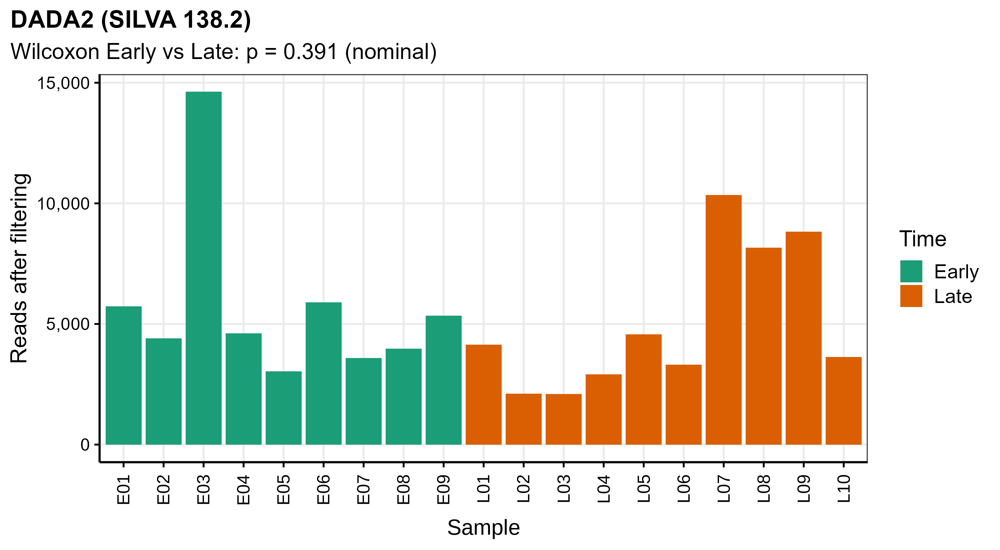
<p class="caption">
Figure 1. Reads per sample after filtering.
</p>

</div>

| time  |   n | Min   | Median | Max    |
|:------|----:|:------|:-------|:-------|
| Early |   9 | 3,034 | 4,617  | 14,625 |
| Late  |  10 | 2,092 | 3,889  | 10,350 |

Table 3. Library size by condition

Depth varies about seven-fold within groups, but not between them
(Wilcoxon p = 0.39). Group differences are therefore not driven by
sequencing depth.

------------------------------------------------------------------------

# 5. Alpha rarefaction

``` r
otu <- t(as(otu_table(ps), "matrix"))                   # samples in rows
vegan::rarecurve(otu, step = 50)
ps_rare <- rarefy_even_depth(ps, sample.size = min(sample_sums(ps)), rngseed = 2026)
```

<div class="figure" style="text-align: center">

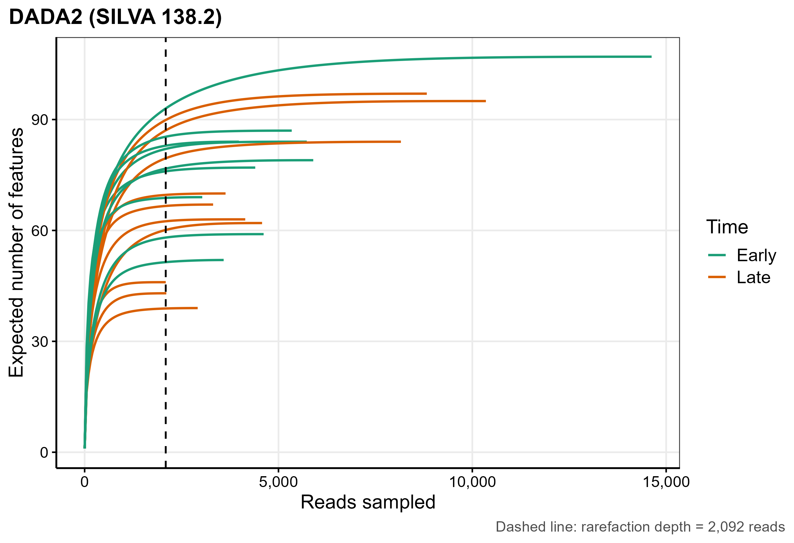
<p class="caption">
Figure 2. Rarefaction curves; dashed line = rarefaction depth (2,092
reads).
</p>

</div>

All curves plateau before 2,092 reads, so rarefying keeps nearly all
richness. Rarefied data are used only for alpha diversity \[25\].

------------------------------------------------------------------------

# 6. Alpha diversity

``` r
alpha <- ps_rare |>
  ps_calc_richness(rank = "unique", index = "observed") |>
  ps_calc_diversity(rank = "unique", index = "shannon") |>
  samdat_tbl()
alpha$pielou <- microbiome::evenness(ps_rare, index = "pielou")$pielou
wilcox.test(shannon_unique ~ time, data = alpha)
```

<div class="figure" style="text-align: center">

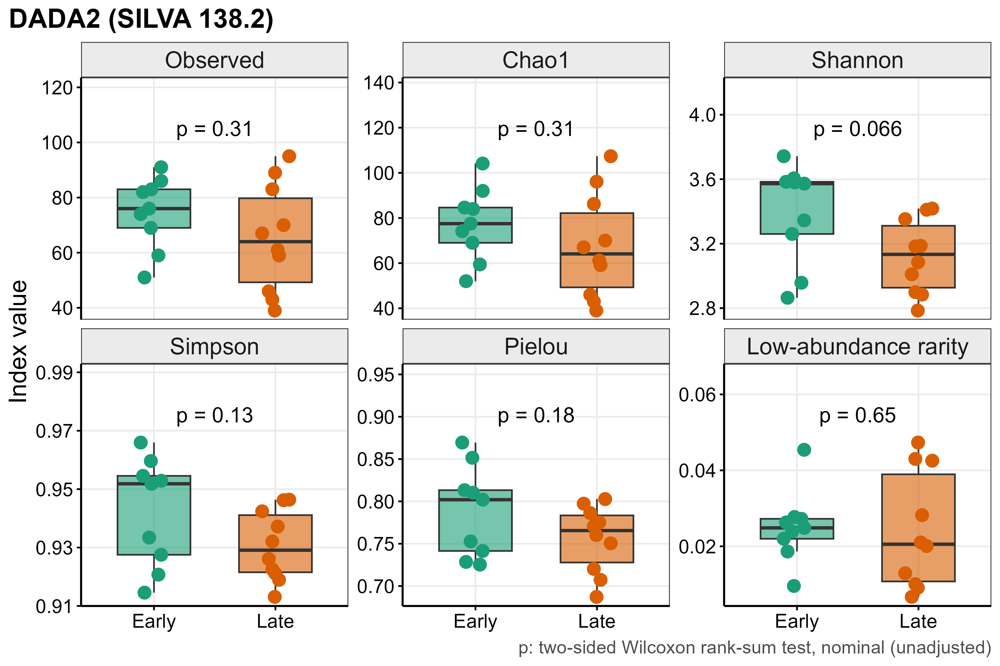
<p class="caption">
Figure 3. Alpha diversity (rarefied to 2,092 reads); two-sided Wilcoxon
p, nominal.
</p>

</div>

- **Richness** does not differ (Observed and Chao1, p = 0.31).
- **Diversity and evenness** (Shannon, Simpson, Pielou) tend to be lower
  in Late samples (p = 0.066–0.18).

The two life stages carry similar diversity: *which* taxa dominate
changes, not how many there are.

------------------------------------------------------------------------

# 7. Relative abundance

``` r
ps_genus |> comp_barplot(tax_level = "Genus", n_taxa = 15, facet_by = "time")   # per sample
ps_genus |> tax_transform("compositional") |> ps_get() |>
  merge_samples(group = "time") |> comp_barplot(tax_level = "Genus", n_taxa = 15) # per condition
```

<div class="figure" style="text-align: center">

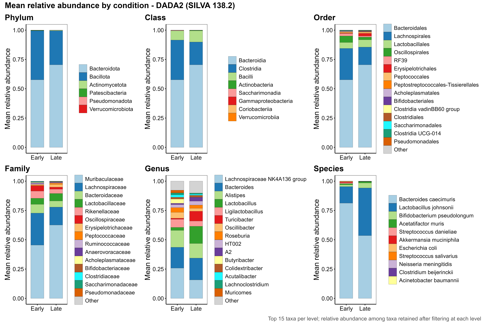
<p class="caption">
Figure 4. Mean relative abundance of the 15 most abundant taxa per
level, Early vs Late.
</p>

</div>

| Level   | Taxon                         | Early (%) | Late (%) |
|:--------|:------------------------------|----------:|---------:|
| Phylum  | Bacteroidota                  |      57.7 |     70.4 |
| Phylum  | Bacillota                     |      41.8 |     29.0 |
| Phylum  | Actinomycetota                |       0.1 |      0.4 |
| Phylum  | Patescibacteria               |       0.3 |      0.1 |
| Phylum  | Pseudomonadota                |       0.1 |      0.0 |
| Family  | Muribaculaceae                |      45.5 |     62.6 |
| Family  | Lachnospiraceae               |      27.3 |     15.3 |
| Family  | Bacteroidaceae                |       7.5 |      5.3 |
| Family  | Lactobacillaceae              |       5.2 |      6.4 |
| Family  | Rikenellaceae                 |       6.1 |      3.7 |
| Genus   | Lachnospiraceae NK4A136 group |      25.8 |     15.8 |
| Genus   | Bacteroides                   |      17.8 |     18.6 |
| Genus   | Alistipes                     |      14.4 |     12.5 |
| Genus   | Lactobacillus                 |       2.6 |     14.7 |
| Genus   | Ligilactobacillus             |       6.9 |      4.5 |
| Species | Bacteroides caecimuris        |      81.3 |     53.6 |
| Species | Lactobacillus johnsonii       |      14.1 |     40.6 |
| Species | Bifidobacterium pseudolongum  |       1.6 |      4.3 |
| Species | Acetatifactor muris           |       1.0 |      1.2 |
| Species | Streptococcus danieliae       |       0.8 |      0.0 |

Table 4. Mean relative abundance (%) of the five most abundant taxa per
level.

<div class="figure" style="text-align: center">

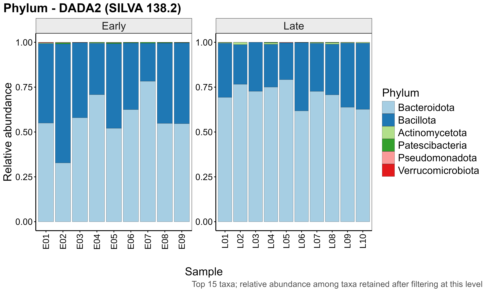
<p class="caption">
Figure 5. Phylum level, per sample.
</p>

</div>

<div class="figure" style="text-align: center">

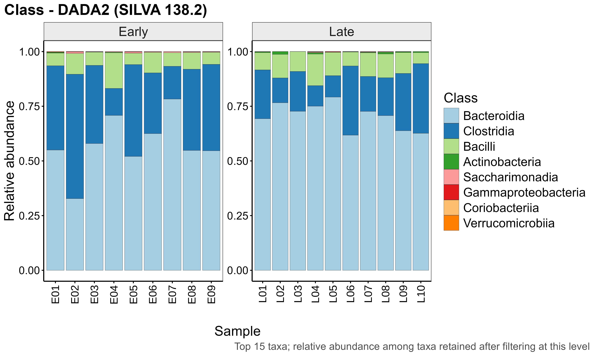
<p class="caption">
Figure 6. Class level, per sample.
</p>

</div>

<div class="figure" style="text-align: center">


<p class="caption">
Figure 7. Order level, per sample.
</p>

</div>

<div class="figure" style="text-align: center">

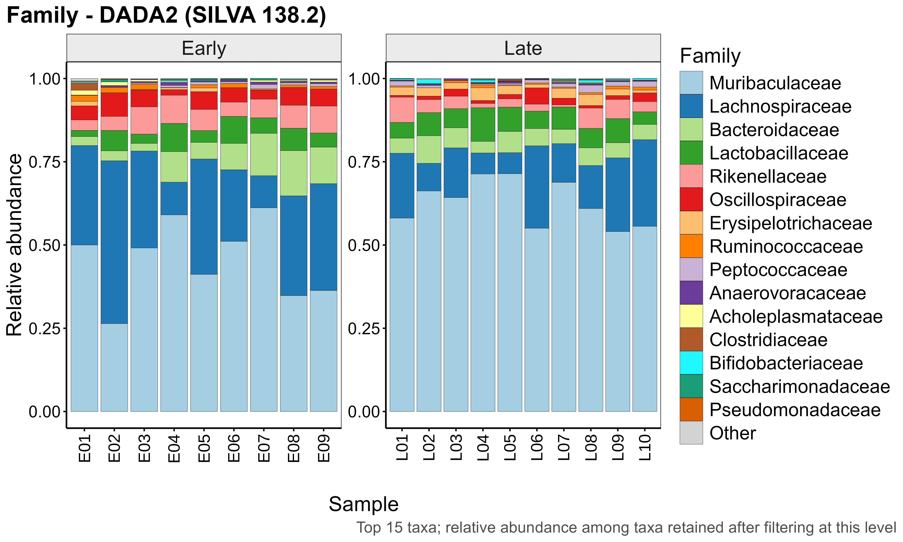
<p class="caption">
Figure 8. Family level, per sample.
</p>

</div>

<div class="figure" style="text-align: center">

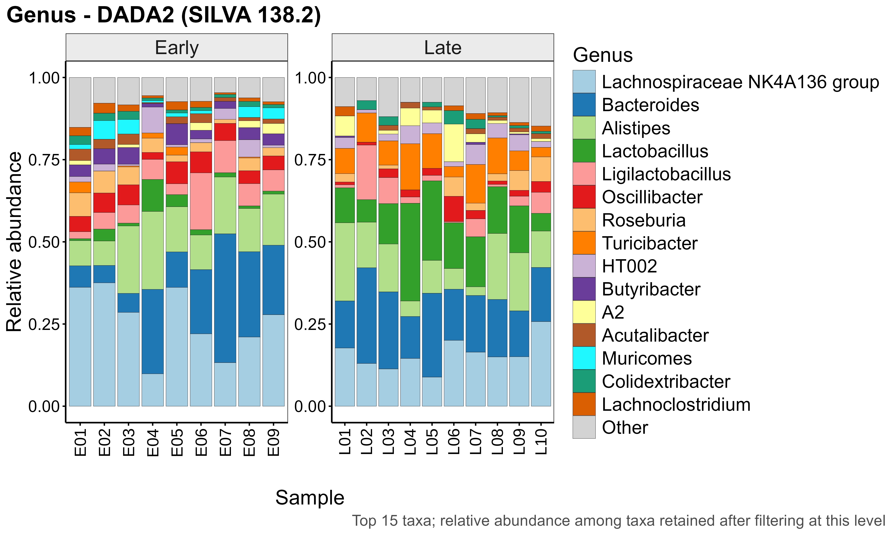
<p class="caption">
Figure 9. Genus level, per sample.
</p>

</div>

<div class="figure" style="text-align: center">

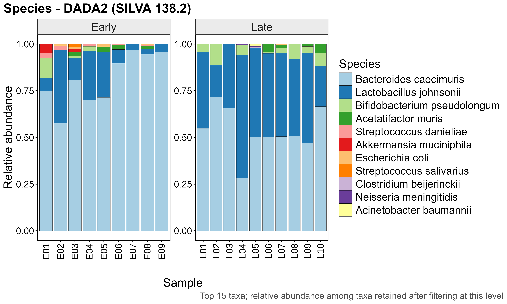
<p class="caption">
Figure 10. Species level, per sample.
</p>

</div>

- **Phylum.** *Bacteroidota* rises from 58% to 70% and *Bacillota* falls
  from 42% to 29%. Early samples vary more: E02 has only about 33%
  Bacteroidota.
- **Family.** *Muribaculaceae* rises from 45% to 63%; *Lachnospiraceae*
  falls from 27% to 15%, and *Oscillospiraceae* also falls.
- **Genus.** *Lactobacillus* (3% → 15%) and *Turicibacter* (1% → 8%)
  expand, while *Muricomes* and *Butyribacter* almost disappear.
- **Species** (8.5% of reads). *L. johnsonii* rises from 14% to 41%, and
  *B. caecimuris* falls from 81% to 54%.

------------------------------------------------------------------------

# 8. Beta diversity (Bray–Curtis PCoA)

``` r
ps |> tax_transform("compositional", rank = "unique") |>
  dist_calc("bray") |> ord_calc(method = "PCoA") |>
  ord_plot(colour = "time")
```

<div class="figure" style="text-align: center">

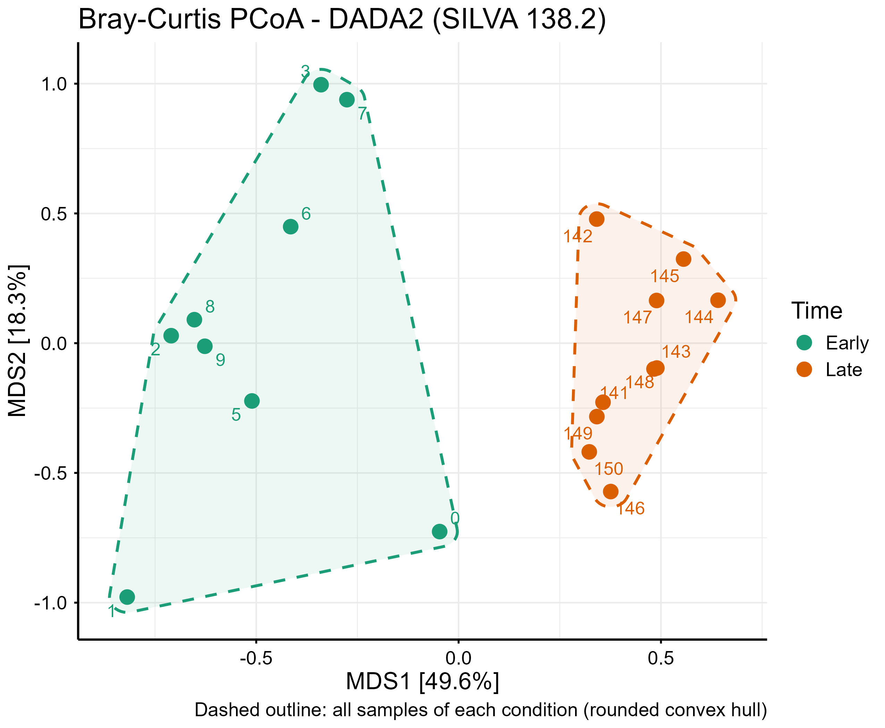
<p class="caption">
Figure 11. Bray–Curtis PCoA of all 163 features; point labels = day.
</p>

</div>

- **MDS1 (49.6%) fully separates Early from Late.**
- **Early samples are dispersed:** E01 and E02 (days 0–1) lie far from
  E04 and E07.
- **Late samples cluster tightly,** reflecting the post-weaning
  stabilisation described for this dataset \[8\].

------------------------------------------------------------------------

# 9. PERMANOVA by level

``` r
d <- ps |> tax_transform("compositional", rank = "unique") |> dist_calc("bray")
d |> dist_permanova(variables = "time", n_perms = 9999, seed = 2026) |> perm_get()  # PERMANOVA
d |> dist_bdisp(variables = "time") |> bdisp_get()                                  # PERMDISP
```

| Level        | Features | R² (%) | p       | p_adj   | PERMDISP p | PERMDISP p_adj |
|:-------------|---------:|-------:|:--------|:--------|:-----------|:---------------|
| All features |      163 |   44.3 | 1.0e-04 | 7.0e-04 | 0.003      | 0.018          |
| Phylum       |        6 |   32.7 | 0.008   | 0.009   | 0.226      | 0.317          |
| Class        |        8 |   30.0 | 0.013   | 0.013   | 0.222      | 0.317          |
| Order        |       21 |   31.7 | 0.008   | 0.009   | 0.180      | 0.317          |
| Family       |       28 |   37.4 | 0.002   | 0.003   | 0.056      | 0.196          |
| Genus        |       47 |   33.9 | 2.0e-04 | 7.0e-04 | 0.898      | 0.898          |
| Species      |       11 |   50.8 | 6.0e-04 | 0.001   | 0.549      | 0.640          |

Table 5. PERMANOVA and PERMDISP (Bray–Curtis, 9,999 permutations; p_adj
= BH across levels).

PERMANOVA \[26\] tests whether the group centroids differ; PERMDISP
\[27\] tests whether the groups differ in spread. p-values are
BH-adjusted across levels \[28\].

- **Condition explains 30–51% of the variation at every level** (44% for
  all features); all levels have p_adj ≤ 0.013.
- **Dispersion differs only for all features** (p = 0.003, the variable
  Early community). At every taxonomic level PERMDISP is not
  significant, so the shift is a genuine change of centroid.

------------------------------------------------------------------------

# 10. Differential abundance (ANCOM-BC2)

``` r
res <- ANCOMBC::ancombc2(data = ps, tax_level = "Genus", fix_formula = "time",
                         p_adj_method = "holm", prv_cut = 0.10, pseudo_sens = TRUE)
res$res[, c("taxon", "lfc_timeLate", "q_timeLate", "diff_timeLate", "passed_ss_timeLate")]
```

ANCOM-BC2 \[23\] corrects for sample-specific sampling bias and tests
each taxon’s **log-fold change** (LFC, natural log, Late vs Early).

- **Settings.** q-values are Holm-adjusted \[29\]. The bias is estimated
  from all 163 features.
- **Pseudo-count fit.** Taxa absent from one condition are refitted with
  a pseudo-count of 1, so every taxon is tested.
- **Robust.** A result counts as robust when q \< 0.05 *and* it passes
  the pseudo-count sensitivity analysis.

| Level   | Taxa_tested | Tested_pseudocount | Not_tested | Significant_q05 | Also_pass_sensitivity | Higher_in_Late | Higher_in_Early |
|:--------|------------:|-------------------:|-----------:|----------------:|----------------------:|---------------:|----------------:|
| Phylum  |           6 |                  1 |          0 |               1 |                     0 |              0 |               0 |
| Class   |           8 |                  1 |          0 |               0 |                     0 |              0 |               0 |
| Order   |          21 |                  3 |          0 |               2 |                     1 |              1 |               0 |
| Family  |          28 |                  8 |          0 |               2 |                     1 |              1 |               0 |
| Genus   |          47 |                 13 |          0 |               8 |                     4 |              1 |               3 |
| Species |          11 |                  6 |          0 |               1 |                     0 |              0 |               0 |

Table 6. ANCOM-BC2 summary per level
(results/dada2/ancombc2_results_by_level.xlsx, sheet ‘Summary’).

Each level has a table and a top-5 boxplot. The boxplots show the five
lowest-p taxa, regardless of significance, as per-sample relative
abundance.

#### Phylum

| Taxon             | Early % | Late % | Present E/L |   LFC | q     | Wilcoxon p | Robust | Fit            |
|:------------------|--------:|-------:|:------------|------:|:------|:-----------|:-------|:---------------|
| Actinomycetota    |    0.09 |   0.45 | 5/8         |  1.73 | 0.012 | 0.034      | FALSE  | primary        |
| Bacteroidota      |   57.66 |  70.44 | 9/10        |  0.40 | 0.628 | 0.016      | FALSE  | primary        |
| Patescibacteria   |    0.31 |   0.10 | 8/7         | -0.44 | 1.000 | 0.049      | FALSE  | primary        |
| Verrucomicrobiota |    0.02 |   0.00 | 2/0         | -0.38 | 1.000 | 0.146      | FALSE  | pseudo-count 1 |
| Bacillota         |   41.82 |  28.97 | 9/10        | -0.17 | 1.000 | 0.013      | FALSE  | primary        |
| Pseudomonadota    |    0.10 |   0.04 | 7/4         | -0.04 | 1.000 | 0.046      | FALSE  | primary        |

Table 7a. ANCOM-BC2, Phylum (6 taxa; ten lowest p). Present E/L =
samples with reads (of 9/10).

<div class="figure" style="text-align: center">

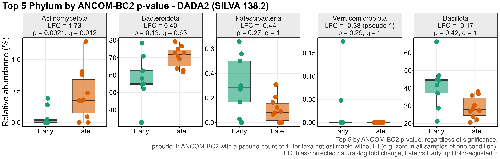
<p class="caption">
Figure 12. Top-5 phyla by ANCOM-BC2 p-value.
</p>

</div>

- **Actinomycetota** is higher in Late (LFC +1.73, q = 0.012) but fails
  the sensitivity analysis.
- **Bacteroidota and Bacillota** shift in proportion (Wilcoxon p ≤
  0.016) with small bias-corrected LFCs (q ≥ 0.63). The shift is
  **compositional**: two phyla make up more than 99% of reads.

#### Class

| Taxon               | Early % | Late % | Present E/L |   LFC | q     | Wilcoxon p | Robust | Fit            |
|:--------------------|--------:|-------:|:------------|------:|:------|:-----------|:-------|:---------------|
| Actinobacteria      |    0.08 |   0.42 | 3/8         |  1.06 | 0.219 | 0.025      | FALSE  | primary        |
| Coriobacteriia      |    0.01 |   0.02 | 2/3         |  0.82 | 0.453 | 0.674      | FALSE  | primary        |
| Bacteroidia         |   57.66 |  70.44 | 9/10        |  0.40 | 0.943 | 0.016      | FALSE  | primary        |
| Clostridia          |   33.87 |  19.41 | 9/10        | -0.37 | 1.000 | 0.020      | FALSE  | primary        |
| Bacilli             |    7.95 |   9.56 | 9/10        |  0.39 | 1.000 | 0.111      | FALSE  | primary        |
| Saccharimonadia     |    0.31 |   0.10 | 8/7         | -0.44 | 1.000 | 0.049      | FALSE  | primary        |
| Verrucomicrobiia    |    0.02 |   0.00 | 2/0         | -0.38 | 1.000 | 0.146      | FALSE  | pseudo-count 1 |
| Gammaproteobacteria |    0.10 |   0.04 | 7/4         | -0.04 | 1.000 | 0.046      | FALSE  | primary        |

Table 7b. ANCOM-BC2, Class (8 taxa; ten lowest p). Present E/L = samples
with reads (of 9/10).

<div class="figure" style="text-align: center">

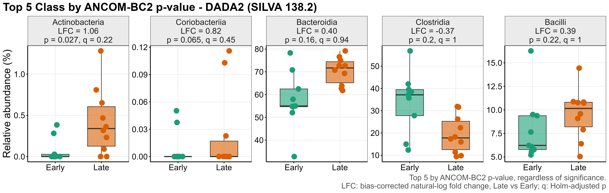
<p class="caption">
Figure 13. Top-5 classes by ANCOM-BC2 p-value.
</p>

</div>

**No class reaches q \< 0.05.** Clostridia halves in proportion (37% →
18%) without a significant bias-corrected change.

#### Order

| Taxon                      | Early % | Late % | Present E/L |   LFC | q     | Wilcoxon p | Robust | Fit     |
|:---------------------------|--------:|-------:|:------------|------:|:------|:-----------|:-------|:--------|
| Clostridiales              |    0.24 |   0.20 | 1/8         | -1.99 | 0.004 | 0.019      | FALSE  | primary |
| Erysipelotrichales         |    0.36 |   2.31 | 5/10        |  1.74 | 0.012 | 9.0e-04    | TRUE   | primary |
| Oscillospirales            |    5.51 |   2.26 | 9/10        | -0.76 | 0.366 | 0.003      | FALSE  | primary |
| Bifidobacteriales          |    0.08 |   0.42 | 3/8         |  1.06 | 0.475 | 0.025      | FALSE  | primary |
| Acholeplasmatales          |    0.54 |   0.03 | 8/2         | -0.89 | 0.567 | 0.001      | FALSE  | primary |
| Clostridia UCG-014         |    0.09 |   0.26 | 5/9         |  0.76 | 0.575 | 0.029      | FALSE  | primary |
| Christensenellales         |    0.02 |   0.05 | 3/5         |  0.67 | 0.709 | 0.340      | FALSE  | primary |
| Coriobacteriales           |    0.01 |   0.02 | 2/3         |  0.82 | 0.874 | 0.674      | FALSE  | primary |
| Peptococcales              |    0.57 |   0.99 | 8/9         |  0.79 | 1.000 | 0.165      | FALSE  | primary |
| Clostridia vadinBB60 group |    0.21 |   0.27 | 8/10        |  0.56 | 1.000 | 0.348      | FALSE  | primary |

Table 7c. ANCOM-BC2, Order (21 taxa; ten lowest p). Present E/L =
samples with reads (of 9/10).

<div class="figure" style="text-align: center">

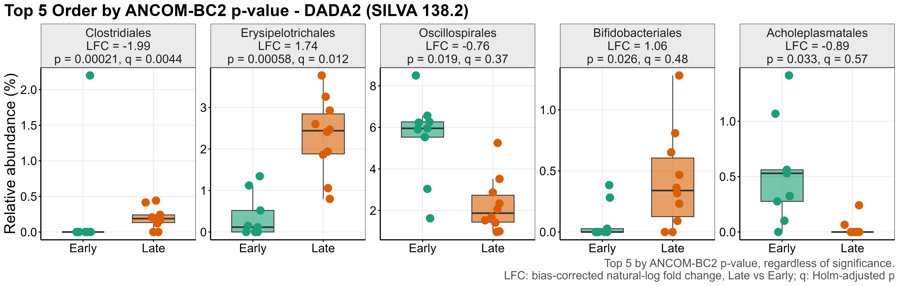
<p class="caption">
Figure 14. Top-5 orders by ANCOM-BC2 p-value.
</p>

</div>

- **Erysipelotrichales is robustly higher in Late** (0.1% → 2.5%; LFC
  +1.74).
- **Clostridiales is an artefact:** its LFC rests on a single Early
  sample, E01, and the sensitivity analysis flags it.

#### Family

| Taxon               | Early % | Late % | Present E/L |   LFC | q     | Wilcoxon p | Robust | Fit            |
|:--------------------|--------:|-------:|:------------|------:|:------|:-----------|:-------|:---------------|
| Clostridiaceae      |    0.25 |   0.20 | 1/8         | -1.99 | 0.006 | 0.019      | FALSE  | primary        |
| Erysipelotrichaceae |    0.37 |   2.34 | 5/10        |  1.74 | 0.016 | 9.0e-04    | TRUE   | primary        |
| Oscillospiraceae    |    4.53 |   1.73 | 9/10        | -0.91 | 0.213 | 0.002      | FALSE  | primary        |
| Streptococcaceae    |    0.06 |   0.00 | 6/0         | -1.04 | 0.409 | 0.004      | FALSE  | pseudo-count 1 |
| Bifidobacteriaceae  |    0.08 |   0.43 | 3/8         |  1.06 | 0.634 | 0.025      | FALSE  | primary        |
| Acholeplasmataceae  |    0.55 |   0.03 | 8/2         | -0.89 | 0.767 | 0.001      | FALSE  | primary        |
| Christensenellaceae |    0.02 |   0.05 | 3/5         |  0.67 | 1.000 | 0.340      | FALSE  | primary        |
| Muribaculaceae      |   45.47 |  62.59 | 9/10        |  0.53 | 1.000 | 0.004      | FALSE  | primary        |
| Peptococcaceae      |    0.58 |   1.00 | 8/9         |  0.79 | 1.000 | 0.165      | FALSE  | primary        |
| Eggerthellaceae     |    0.01 |   0.02 | 2/3         |  0.72 | 1.000 | 0.674      | FALSE  | primary        |

Table 7d. ANCOM-BC2, Family (28 taxa; ten lowest p). Present E/L =
samples with reads (of 9/10).

<div class="figure" style="text-align: center">

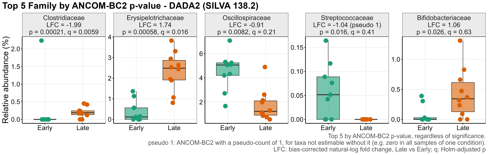
<p class="caption">
Figure 15. Top-5 families by ANCOM-BC2 p-value.
</p>

</div>

- **Erysipelotrichaceae is robust** (LFC +1.74, q = 0.016).
- **Clostridiaceae** is the same E01 artefact.
- **Oscillospiraceae** (5% → 1.2%) and the Early-only
  **Streptococcaceae** do not survive correction.

#### Genus

| Taxon         | Early % | Late % | Present E/L |   LFC | q       | Wilcoxon p | Robust | Fit            |
|:--------------|--------:|-------:|:------------|------:|:--------|:-----------|:-------|:---------------|
| Muricomes     |    2.32 |   0.00 | 8/0         | -3.34 | 3.1e-04 | 3.3e-04    | TRUE   | pseudo-count 1 |
| Butyribacter  |    3.64 |   0.14 | 9/3         | -2.05 | 0.002   | 1.9e-04    | TRUE   | primary        |
| Anaerotruncus |    0.07 |   0.82 | 3/7         |  1.52 | 0.015   | 0.022      | FALSE  | primary        |
| Clostridium   |    0.60 |   0.60 | 1/7         | -2.02 | 0.015   | 0.041      | FALSE  | primary        |
| Lactobacillus |    2.56 |  14.67 | 9/10        |  1.83 | 0.016   | 5.2e-04    | FALSE  | primary        |
| ASF356        |    0.41 |   0.00 | 7/0         | -1.90 | 0.018   | 0.001      | TRUE   | pseudo-count 1 |
| Turicibacter  |    0.88 |   8.33 | 5/10        |  1.74 | 0.023   | 4.9e-04    | TRUE   | primary        |
| Faecalimonas  |    0.31 |   0.86 | 8/7         |  1.01 | 0.026   | 0.119      | FALSE  | primary        |
| Extibacter    |    0.05 |   1.67 | 1/7         |  1.42 | 0.088   | 0.007      | FALSE  | primary        |
| Oscillibacter |    5.03 |   2.50 | 9/10        | -1.11 | 0.100   | 0.013      | FALSE  | primary        |

Table 7e. ANCOM-BC2, Genus (47 taxa; ten lowest p). Present E/L =
samples with reads (of 9/10).

<div class="figure" style="text-align: center">

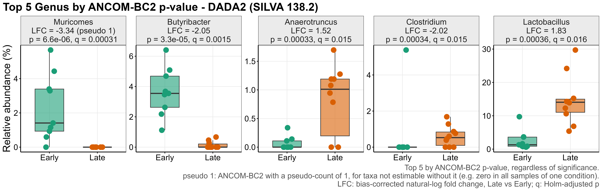
<p class="caption">
Figure 16. Top-5 genera by ANCOM-BC2 p-value.
</p>

</div>

- **Robust, higher in Early:**
  - ***Muricomes*** (8/9 Early, 0/10 Late; LFC −3.34);
  - ***Butyribacter*** (LFC −2.05);
  - ***ASF356*** (7/9 Early, 0/10 Late).
- **Robust, higher in Late:** ***Turicibacter*** (0.9% → 8.3%; LFC
  +1.74).
- **Probable:** ***Lactobacillus*** (1.3% → 14%; LFC +1.83, q = 0.016)
  and ***Anaerotruncus*** fail only the sensitivity analysis.
- ***Clostridium*** is the E01 artefact.

#### Species

| Taxon                        | Early % | Late % | Present E/L |   LFC | q     | Wilcoxon p | Robust | Fit            |
|:-----------------------------|--------:|-------:|:------------|------:|:------|:-----------|:-------|:---------------|
| Lactobacillus johnsonii      |   14.06 |  40.61 | 9/10        |  1.83 | 0.004 | 0.002      | FALSE  | primary        |
| Bifidobacterium pseudolongum |    1.57 |   4.29 | 3/8         |  1.06 | 0.264 | 0.046      | FALSE  | primary        |
| Acetatifactor muris          |    0.97 |   1.20 | 4/4         |  0.57 | 0.678 | 0.964      | FALSE  | primary        |
| Streptococcus danieliae      |    0.78 |   0.00 | 5/0         | -0.82 | 0.753 | 0.010      | FALSE  | pseudo-count 1 |
| Akkermansia muciniphila      |    0.74 |   0.00 | 2/0         | -0.38 | 1.000 | 0.146      | FALSE  | pseudo-count 1 |
| Neisseria meningitidis       |    0.00 |   0.11 | 0/2         |  0.36 | 1.000 | 0.193      | FALSE  | pseudo-count 1 |
| Clostridium beijerinckii     |    0.00 |   0.09 | 0/1         |  0.29 | 1.000 | 0.399      | FALSE  | pseudo-count 1 |
| Acinetobacter baumannii      |    0.00 |   0.09 | 0/1         |  0.29 | 1.000 | 0.399      | FALSE  | pseudo-count 1 |
| Escherichia coli             |    0.45 |   0.05 | 4/1         |  0.19 | 1.000 | 0.073      | FALSE  | primary        |
| Streptococcus salivarius     |    0.16 |   0.00 | 1/0         | -0.10 | 1.000 | 0.343      | FALSE  | pseudo-count 1 |

Table 7f. ANCOM-BC2, Species (11 taxa; ten lowest p). Present E/L =
samples with reads (of 9/10).

<div class="figure" style="text-align: center">

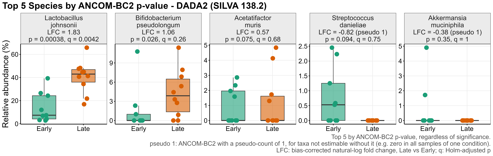
<p class="caption">
Figure 17. Top-5 species by ANCOM-BC2 p-value (% of species-classified
reads).
</p>

</div>

- ***L. johnsonii*** (7% → 43%; LFC +1.83) carries the *Lactobacillus*
  signal and is probable, not robust.
- ***S. danieliae*** and ***A. muciniphila*** (in E01 and E03 only) are
  Early-only but too rare to test reliably.

------------------------------------------------------------------------

# 11. Summary of the taxonomic analysis (DADA2)

| Level  | Taxon               |   LFC | q       | Higher in |
|:-------|:--------------------|------:|:--------|:----------|
| Order  | Erysipelotrichales  |  1.74 | 0.012   | Late      |
| Family | Erysipelotrichaceae |  1.74 | 0.016   | Late      |
| Genus  | Muricomes           | -3.34 | 3.1e-04 | Early     |
| Genus  | Butyribacter        | -2.05 | 0.002   | Early     |
| Genus  | ASF356              | -1.90 | 0.018   | Early     |
| Genus  | Turicibacter        |  1.74 | 0.023   | Late      |

Table 8. Robust ANCOM-BC2 differences (q \< 0.05 and passed sensitivity
analysis).

- **Data.** Depth is balanced between conditions, and the rarefaction
  curves plateau.
- **Diversity vs composition.** Diversity is unchanged, but composition
  shifts strongly: R² = 44%, with complete separation on MDS1. The Early
  community is variable and the Late community stable.
- **Proportions.** Bacteroidota/Muribaculaceae and lactobacilli expand;
  Clostridia (Lachnospiraceae, Oscillospiraceae) contract.
- **Robust bias-corrected changes.**
  *Erysipelotrichaceae*/*Turicibacter* go up; *Muricomes*,
  *Butyribacter* and *ASF356* go down. *Lactobacillus* is a probable
  increase.
- **Limitations.**
  - The samples are repeated measures of **one mouse**: the p-values
    describe two periods in this animal and cannot be generalised.
  - Age is confounded with diet and housing.
  - 16S data are relative.
  - Only 35.5% of reads have a named genus.
  - Single-sample results (E01) must be checked with `Present E/L`.

------------------------------------------------------------------------

# 12. QIIME 2 taxonomy (SILVA 138)

``` r
ps_q2 <- readRDS("results/phyloseq/qiime2_phyloseq.rds")
# Taxon_1..Taxon_7 -> Kingdom..Species, prefixes ("p__", "g__") removed, then Sections 3-10
```

The counts are identical to DADA2’s, so Figures 1–3 and 11 also apply
here. Only the taxonomy-dependent results are shown.

## 12.1 Relative abundance

<div class="figure" style="text-align: center">

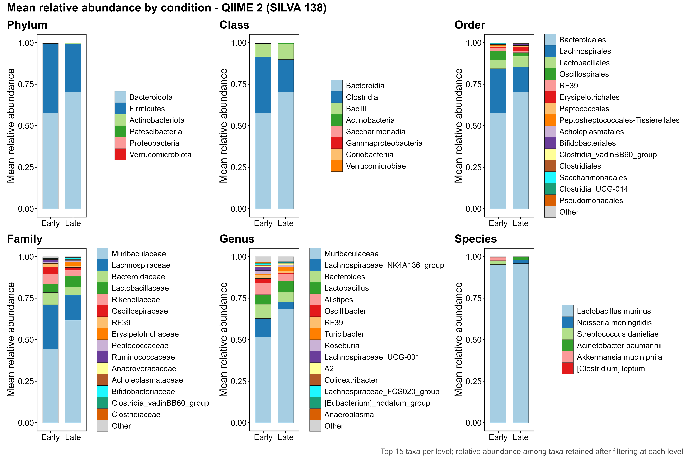
<p class="caption">
Figure 18. QIIME 2: mean relative abundance of the 15 most abundant taxa
per level.
</p>

</div>

| Level   | Taxon                         | Early (%) | Late (%) |
|:--------|:------------------------------|----------:|---------:|
| Family  | Muribaculaceae                |      44.3 |     61.6 |
| Family  | Lachnospiraceae               |      26.7 |     15.1 |
| Family  | Bacteroidaceae                |       7.3 |      5.2 |
| Family  | Lactobacillaceae              |       5.0 |      6.3 |
| Family  | Rikenellaceae                 |       6.0 |      3.6 |
| Genus   | Muribaculaceae                |      51.5 |     68.4 |
| Genus   | Lachnospiraceae_NK4A136_group |      11.3 |      4.4 |
| Genus   | Bacteroides                   |       8.5 |      5.8 |
| Genus   | Lactobacillus                 |       5.9 |      6.9 |
| Genus   | Alistipes                     |       7.0 |      4.1 |
| Species | Lactobacillus murinus         |      95.2 |     95.9 |
| Species | Streptococcus danieliae       |       2.4 |      0.0 |
| Species | Neisseria meningitidis        |       0.0 |      2.3 |
| Species | Akkermansia muciniphila       |       1.9 |      0.0 |
| Species | Acinetobacter baumannii       |       0.0 |      1.9 |

Table 9. QIIME 2: mean relative abundance (%) of the five most abundant
taxa per level.

<div class="figure" style="text-align: center">


<p class="caption">
Figure 19. QIIME 2, phylum level, per sample.
</p>

</div>

<div class="figure" style="text-align: center">


<p class="caption">
Figure 20. QIIME 2, class level, per sample.
</p>

</div>

<div class="figure" style="text-align: center">

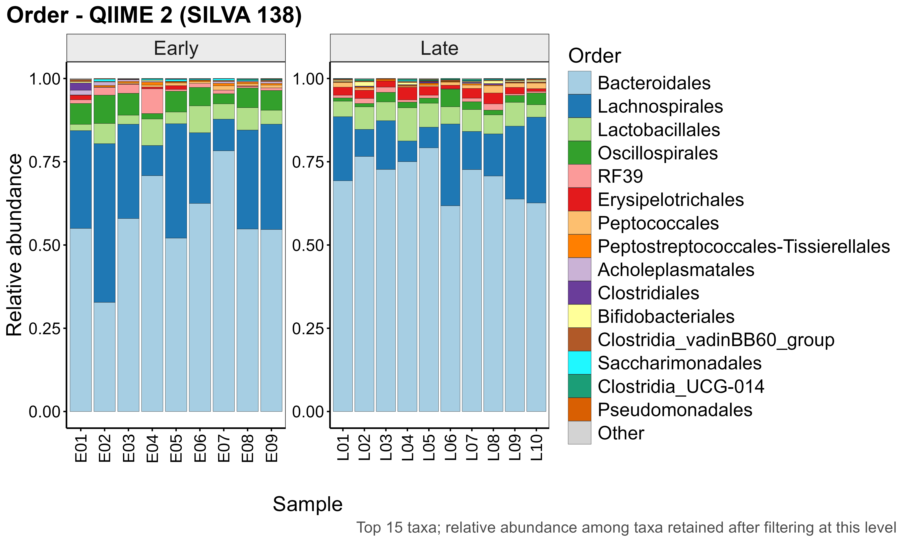
<p class="caption">
Figure 21. QIIME 2, order level, per sample.
</p>

</div>

<div class="figure" style="text-align: center">

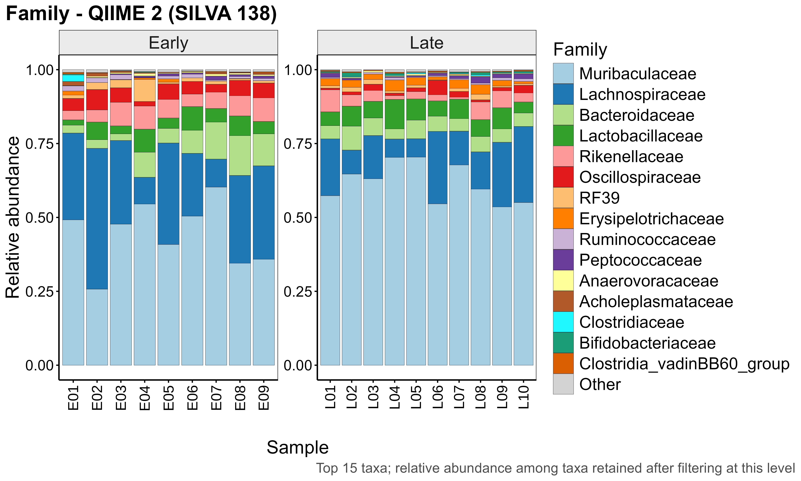
<p class="caption">
Figure 22. QIIME 2, family level, per sample.
</p>

</div>

<div class="figure" style="text-align: center">

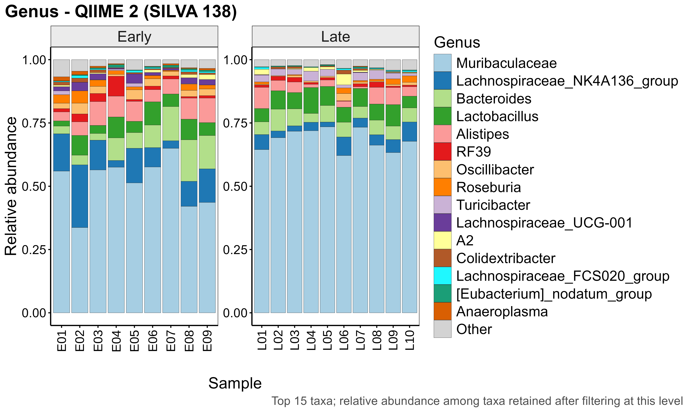
<p class="caption">
Figure 23. QIIME 2, genus level, per sample.
</p>

</div>

<div class="figure" style="text-align: center">

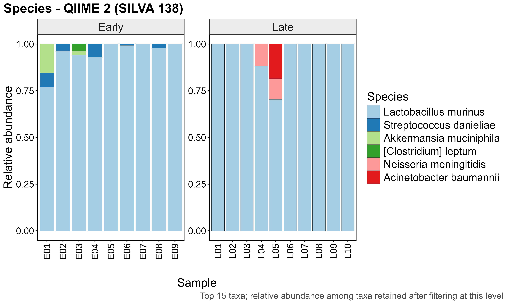
<p class="caption">
Figure 24. QIIME 2, species level, per sample.
</p>

</div>

- **Phylum to family match DADA2,** with the older names: Firmicutes =
  Bacillota.

- **The genus panel is dominated by the *Muribaculaceae* placeholder**
  (51% → 68%).

- ***Lactobacillus* looks flat (5.9% → 6.9%)** because SILVA 138 pools
  three SILVA 138.2 genera that change in opposite directions:

  | SILVA 138.2 genus (% of all reads)   | Early | Late | Wilcoxon p |
  |--------------------------------------|-------|------|------------|
  | *Lactobacillus*                      | 1.0   | 4.1  | 0.002      |
  | *Ligilactobacillus*                  | 2.9   | 1.2  | 0.013      |
  | HT002                                | 1.1   | 1.0  | 0.65       |
  | pooled (= SILVA 138 *Lactobacillus*) | 5.0   | 6.3  | 0.27       |

- **The species level is uninformative.** About 95% of the species-level
  reads are one feature, *L. murinus* (= *Ligilactobacillus murinus*
  \[18\]).

## 12.2 PERMANOVA

| Level        | Features | R² (%) | p_adj   | PERMDISP p_adj | DADA2 R² (%) |
|:-------------|---------:|-------:|:--------|:---------------|-------------:|
| All features |      163 |   44.3 | 7.0e-04 | 0.009          |         44.3 |
| Phylum       |        6 |   32.7 | 0.011   | 0.264          |         32.7 |
| Class        |        8 |   30.0 | 0.015   | 0.264          |         30.0 |
| Order        |       21 |   31.7 | 0.011   | 0.264          |         31.7 |
| Family       |       31 |   37.1 | 0.004   | 0.108          |         37.4 |
| Genus        |       47 |   42.5 | 7.0e-04 | 7.0e-04        |         33.9 |
| Species      |        6 |    8.8 | 0.166   | 0.524          |         50.8 |

Table 10. QIIME 2: PERMANOVA and PERMDISP by level, with DADA2 R².

- **All features to order are identical to DADA2.**
- **Genus R² is higher (42.5% vs 33.9%), but dispersion now differs**
  (PERMDISP p_adj \< 0.001) because of the placeholder genus.
- **Species is not significant** (R² 8.8%).

## 12.3 ANCOM-BC2 and top-5 boxplots

| Level   | Taxa_tested | Tested_pseudocount | Not_tested | Significant_q05 | Also_pass_sensitivity | Higher_in_Late | Higher_in_Early |
|:--------|------------:|-------------------:|-----------:|----------------:|----------------------:|---------------:|----------------:|
| Phylum  |           6 |                  1 |          0 |               1 |                     0 |              0 |               0 |
| Class   |           8 |                  1 |          0 |               0 |                     0 |              0 |               0 |
| Order   |          21 |                  3 |          0 |               2 |                     1 |              1 |               0 |
| Family  |          31 |                  8 |          0 |               2 |                     1 |              1 |               0 |
| Genus   |          47 |                 13 |          0 |               5 |                     3 |              1 |               2 |
| Species |           6 |                  5 |          0 |               0 |                     0 |              0 |               0 |

Table 11. QIIME 2: ANCOM-BC2 summary per level.

#### Phylum

| Taxon             | Early % | Late % | Present E/L |   LFC | q     | Wilcoxon p | Robust | Fit            |
|:------------------|--------:|-------:|:------------|------:|:------|:-----------|:-------|:---------------|
| Actinobacteriota  |    0.09 |   0.45 | 5/8         |  1.73 | 0.012 | 0.034      | FALSE  | primary        |
| Bacteroidota      |   57.66 |  70.44 | 9/10        |  0.40 | 0.628 | 0.016      | FALSE  | primary        |
| Patescibacteria   |    0.31 |   0.10 | 8/7         | -0.44 | 1.000 | 0.049      | FALSE  | primary        |
| Verrucomicrobiota |    0.02 |   0.00 | 2/0         | -0.38 | 1.000 | 0.146      | FALSE  | pseudo-count 1 |
| Firmicutes        |   41.82 |  28.97 | 9/10        | -0.17 | 1.000 | 0.013      | FALSE  | primary        |
| Proteobacteria    |    0.10 |   0.04 | 7/4         | -0.04 | 1.000 | 0.046      | FALSE  | primary        |

Table 12a. QIIME 2: ANCOM-BC2, Phylum (6 taxa; ten lowest p). Present
E/L = samples with reads (of 9/10).

<div class="figure" style="text-align: center">

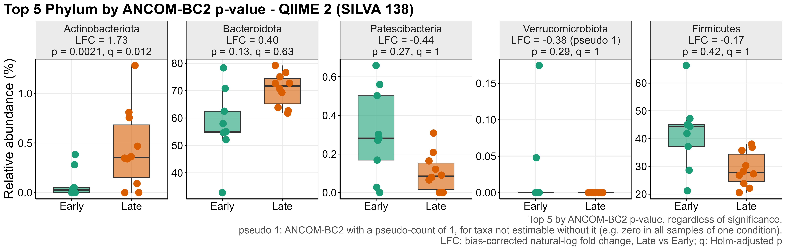
<p class="caption">
Figure 25. QIIME 2: top-5 phyla.
</p>

</div>

#### Class

| Taxon               | Early % | Late % | Present E/L |   LFC | q     | Wilcoxon p | Robust | Fit            |
|:--------------------|--------:|-------:|:------------|------:|:------|:-----------|:-------|:---------------|
| Actinobacteria      |    0.08 |   0.42 | 3/8         |  1.06 | 0.219 | 0.025      | FALSE  | primary        |
| Coriobacteriia      |    0.01 |   0.02 | 2/3         |  0.82 | 0.453 | 0.674      | FALSE  | primary        |
| Bacteroidia         |   57.66 |  70.44 | 9/10        |  0.40 | 0.943 | 0.016      | FALSE  | primary        |
| Clostridia          |   33.87 |  19.41 | 9/10        | -0.37 | 1.000 | 0.020      | FALSE  | primary        |
| Bacilli             |    7.95 |   9.56 | 9/10        |  0.39 | 1.000 | 0.111      | FALSE  | primary        |
| Saccharimonadia     |    0.31 |   0.10 | 8/7         | -0.44 | 1.000 | 0.049      | FALSE  | primary        |
| Verrucomicrobiae    |    0.02 |   0.00 | 2/0         | -0.38 | 1.000 | 0.146      | FALSE  | pseudo-count 1 |
| Gammaproteobacteria |    0.10 |   0.04 | 7/4         | -0.04 | 1.000 | 0.046      | FALSE  | primary        |

Table 12b. QIIME 2: ANCOM-BC2, Class (8 taxa; ten lowest p). Present E/L
= samples with reads (of 9/10).

<div class="figure" style="text-align: center">

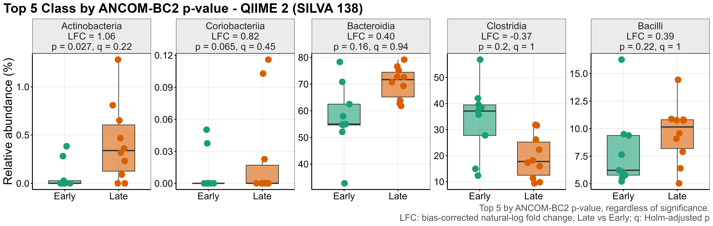
<p class="caption">
Figure 26. QIIME 2: top-5 classes.
</p>

</div>

#### Order

| Taxon                      | Early % | Late % | Present E/L |   LFC | q     | Wilcoxon p | Robust | Fit     |
|:---------------------------|--------:|-------:|:------------|------:|:------|:-----------|:-------|:--------|
| Clostridiales              |    0.24 |   0.20 | 1/8         | -1.99 | 0.004 | 0.019      | FALSE  | primary |
| Erysipelotrichales         |    0.36 |   2.31 | 5/10        |  1.74 | 0.012 | 9.0e-04    | TRUE   | primary |
| Oscillospirales            |    5.51 |   2.26 | 9/10        | -0.76 | 0.366 | 0.003      | FALSE  | primary |
| Bifidobacteriales          |    0.08 |   0.42 | 3/8         |  1.06 | 0.475 | 0.025      | FALSE  | primary |
| Acholeplasmatales          |    0.54 |   0.03 | 8/2         | -0.89 | 0.567 | 0.001      | FALSE  | primary |
| Clostridia_UCG-014         |    0.09 |   0.26 | 5/9         |  0.76 | 0.575 | 0.029      | FALSE  | primary |
| Christensenellales         |    0.02 |   0.05 | 3/5         |  0.67 | 0.709 | 0.340      | FALSE  | primary |
| Coriobacteriales           |    0.01 |   0.02 | 2/3         |  0.82 | 0.874 | 0.674      | FALSE  | primary |
| Peptococcales              |    0.57 |   0.99 | 8/9         |  0.79 | 1.000 | 0.165      | FALSE  | primary |
| Clostridia_vadinBB60_group |    0.21 |   0.27 | 8/10        |  0.56 | 1.000 | 0.348      | FALSE  | primary |

Table 12c. QIIME 2: ANCOM-BC2, Order (21 taxa; ten lowest p). Present
E/L = samples with reads (of 9/10).

<div class="figure" style="text-align: center">


<p class="caption">
Figure 27. QIIME 2: top-5 orders.
</p>

</div>

**Phylum, class and order** (Figures 25–27) are identical to DADA2,
apart from the names.

#### Family

| Taxon               | Early % | Late % | Present E/L |   LFC | q     | Wilcoxon p | Robust | Fit            |
|:--------------------|--------:|-------:|:------------|------:|:------|:-----------|:-------|:---------------|
| Clostridiaceae      |    0.24 |   0.20 | 1/8         | -1.99 | 0.007 | 0.019      | FALSE  | primary        |
| Erysipelotrichaceae |    0.36 |   2.30 | 5/10        |  1.74 | 0.017 | 9.0e-04    | TRUE   | primary        |
| Oscillospiraceae    |    4.44 |   1.71 | 9/10        | -0.91 | 0.238 | 0.002      | FALSE  | primary        |
| Streptococcaceae    |    0.06 |   0.00 | 6/0         | -1.04 | 0.459 | 0.004      | FALSE  | pseudo-count 1 |
| Bifidobacteriaceae  |    0.08 |   0.42 | 3/8         |  1.06 | 0.713 | 0.025      | FALSE  | primary        |
| Acholeplasmataceae  |    0.54 |   0.03 | 8/2         | -0.89 | 0.867 | 0.001      | FALSE  | primary        |
| Clostridia_UCG-014  |    0.09 |   0.26 | 5/9         |  0.76 | 0.899 | 0.029      | FALSE  | primary        |
| Christensenellaceae |    0.02 |   0.05 | 3/5         |  0.67 | 1.000 | 0.340      | FALSE  | primary        |
| Muribaculaceae      |   44.35 |  61.64 | 9/10        |  0.53 | 1.000 | 0.002      | FALSE  | primary        |
| Peptococcaceae      |    0.57 |   0.99 | 8/9         |  0.79 | 1.000 | 0.165      | FALSE  | primary        |

Table 12d. QIIME 2: ANCOM-BC2, Family (31 taxa; ten lowest p). Present
E/L = samples with reads (of 9/10).

<div class="figure" style="text-align: center">

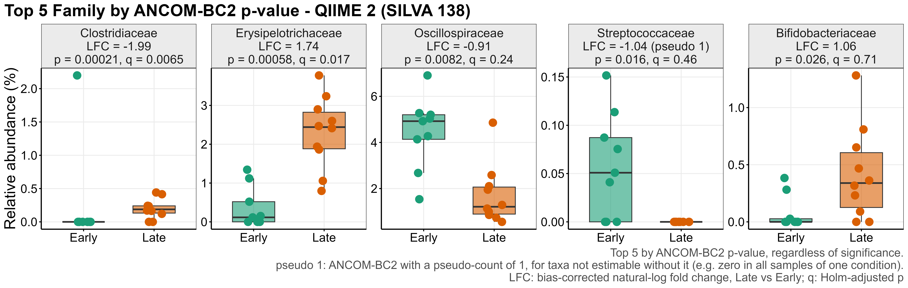
<p class="caption">
Figure 28. QIIME 2: top-5 families.
</p>

</div>

**The same families and LFCs as DADA2.** The q-values are slightly
larger because there are 31 families instead of 28.

#### Genus

| Taxon                               | Early % | Late % | Present E/L |   LFC | q     | Wilcoxon p | Robust | Fit            |
|:------------------------------------|--------:|-------:|:------------|------:|:------|:-----------|:-------|:---------------|
| Lachnospiraceae_UCG-001             |    1.99 |   0.04 | 9/3         | -2.05 | 0.002 | 1.9e-04    | TRUE   | primary        |
| Anaerotruncus                       |    0.04 |   0.27 | 3/7         |  1.52 | 0.015 | 0.022      | FALSE  | primary        |
| Clostridium_sensu_stricto_1         |    0.28 |   0.18 | 1/7         | -2.02 | 0.015 | 0.041      | FALSE  | primary        |
| ASF356                              |    0.21 |   0.00 | 7/0         | -1.90 | 0.018 | 0.001      | TRUE   | pseudo-count 1 |
| Turicibacter                        |    0.42 |   2.53 | 5/10        |  1.74 | 0.024 | 9.0e-04    | TRUE   | primary        |
| Oscillibacter                       |    2.63 |   0.82 | 9/10        | -1.11 | 0.111 | 0.003      | FALSE  | primary        |
| Lachnoclostridium                   |    0.40 |   0.05 | 5/3         | -1.00 | 0.246 | 0.093      | FALSE  | primary        |
| Lachnospiraceae_UCG-004             |    0.17 |   0.33 | 6/6         |  0.85 | 0.623 | 0.426      | FALSE  | primary        |
| Streptococcus                       |    0.07 |   0.00 | 6/0         | -1.04 | 0.653 | 0.004      | FALSE  | pseudo-count 1 |
| \[Eubacterium\]\_xylanophilum_group |    0.18 |   0.03 | 4/2         | -0.91 | 0.868 | 0.151      | FALSE  | primary        |

Table 12e. QIIME 2: ANCOM-BC2, Genus (47 taxa; ten lowest p). Present
E/L = samples with reads (of 9/10).

<div class="figure" style="text-align: center">

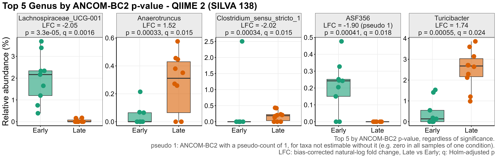
<p class="caption">
Figure 29. QIIME 2: top-5 genera.
</p>

</div>

- **Robust:** *Lachnospiraceae*\_UCG-001 (= DADA2 *Butyribacter*; LFC
  −2.05), *ASF356* and *Turicibacter*.
- **Not testable:** *Muricomes* is not resolved by SILVA 138.
- **No change:** *Lactobacillus* (q = 1), because of the pooling in
  12.1.

#### Species

| Taxon                   | Early % | Late % | Present E/L |   LFC | q     | Wilcoxon p | Robust | Fit            |
|:------------------------|--------:|-------:|:------------|------:|:------|:-----------|:-------|:---------------|
| Lactobacillus murinus   |   95.24 |  95.86 | 9/10        | -1.09 | 0.190 | 0.159      | FALSE  | primary        |
| Streptococcus danieliae |    2.38 |   0.00 | 5/0         | -0.82 | 0.522 | 0.010      | FALSE  | pseudo-count 1 |
| Akkermansia muciniphila |    1.94 |   0.00 | 2/0         | -0.38 | 1.000 | 0.146      | FALSE  | pseudo-count 1 |
| Neisseria meningitidis  |    0.00 |   2.29 | 0/2         |  0.36 | 1.000 | 0.193      | FALSE  | pseudo-count 1 |
| Acinetobacter baumannii |    0.00 |   1.85 | 0/1         |  0.29 | 1.000 | 0.399      | FALSE  | pseudo-count 1 |
| \[Clostridium\] leptum  |    0.43 |   0.00 | 1/0         | -0.18 | 1.000 | 0.343      | FALSE  | pseudo-count 1 |

Table 12f. QIIME 2: ANCOM-BC2, Species (6 taxa; ten lowest p). Present
E/L = samples with reads (of 9/10).

<div class="figure" style="text-align: center">

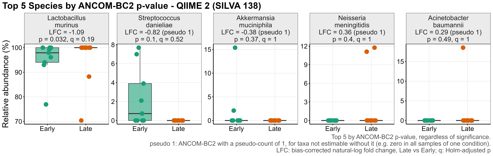
<p class="caption">
Figure 30. QIIME 2: top-5 species (% of species-classified reads).
</p>

</div>

**No species is significant.** The negative LFC of *L. murinus* is a
compositional effect of a near-single-species table.

## 12.4 DADA2 vs QIIME 2

| Level  | DADA2               | QIIME2                  | DADA2 result                           | QIIME 2 result              |
|:-------|:--------------------|:------------------------|:---------------------------------------|:----------------------------|
| Order  | Erysipelotrichales  | Erysipelotrichales      | LFC +1.74, q 0.012 (robust)            | LFC +1.74, q 0.012 (robust) |
| Family | Erysipelotrichaceae | Erysipelotrichaceae     | LFC +1.74, q 0.016 (robust)            | LFC +1.74, q 0.017 (robust) |
| Genus  | Turicibacter        | Turicibacter            | LFC +1.74, q 0.023 (robust)            | LFC +1.74, q 0.024 (robust) |
| Genus  | Butyribacter        | Lachnospiraceae_UCG-001 | LFC -2.05, q 0.002 (robust)            | LFC -2.05, q 0.002 (robust) |
| Genus  | ASF356              | ASF356                  | LFC -1.90, q 0.018 (robust)            | LFC -1.90, q 0.018 (robust) |
| Genus  | Muricomes           | Muricomes               | LFC -3.34, q 3.1e-04 (robust)          | not assigned                |
| Genus  | Lactobacillus       | Lactobacillus           | LFC +1.83, q 0.016 (fails sensitivity) | LFC +0.47, q 1.000          |

Table 13. Key ANCOM-BC2 results with both classifiers (rows pair names
of the same features; Lactobacillus differs in scope).

- **Agreement.** Five of the six robust DADA2 differences are reproduced
  with identical LFCs. These classifier-independent results are the most
  defensible.
- **Differences** come from the reference taxonomy, not the statistics.
- **Recommendation.** Use DADA2 / SILVA 138.2 as the primary taxonomy,
  and QIIME 2 as a check.

------------------------------------------------------------------------

# 13. Functional analysis (PICRUSt2 and ggpicrust2)

## 13.1 PICRUSt2 and ggpicrust2

**PICRUSt2** \[6\] predicts the genes a community carries from its 16S
sequences:

1.  it places each feature in a tree of reference genomes;
2.  it infers the feature’s gene content from its nearest relatives;
3.  it sums that content over the community, weighted by abundance and
    corrected for 16S copy number.

The output is unstratified predicted abundances of enzymes (**EC**),
gene families (**KO**) and **MetaCyc** pathways \[30\].

- **What it adds.** It lets an amplicon study compare functional
  *potential* between groups, test whether a taxonomic shift changes
  function, and point to functions worth validating by metagenomics or
  metabolomics.
- **In ampliseq.** ampliseq 2.18.0 runs PICRUSt2 2.6.3 with the
  PICRUSt2-SC genome database \[31\]; features with NSTI \> 2 are
  excluded.

**ggpicrust2** \[24\] converts KO abundances into **KEGG** pathways
\[32\] and annotates them:

``` r
ko <- read.delim("results/picrust/KO_pred_metagenome_unstrat_descrip.tsv", check.names = FALSE)
ko$description <- NULL                                    # KO IDs + sample columns
kegg <- ggpicrust2::ko2kegg_abundance(data = ko, method = "abundance",
                                      filter_for_prokaryotes = TRUE)
kegg_named <- ggpicrust2::pathway_annotation(data = kegg, pathway = "KEGG")
```

Each table becomes a phyloseq object with functions as “taxa”, and is
analysed with the same tools as Sections 6–10:

``` r
ps_fun <- phyloseq(otu_table(round(as.matrix(kegg)), taxa_are_rows = TRUE), sample_data(ps))
```

| Dataset | Feature                           | Source              | Features |
|---------|-----------------------------------|---------------------|----------|
| EC      | enzyme (Enzyme Commission number) | PICRUSt2            | 1,905    |
| KO      | KEGG ortholog (gene family)       | PICRUSt2            | 4,725    |
| KEGG    | KEGG pathway                      | ggpicrust2, from KO | 228      |
| MetaCyc | metabolic pathway                 | PICRUSt2 (MinPath)  | 376      |

## 13.2 Functional alpha diversity

<div class="figure" style="text-align: center">

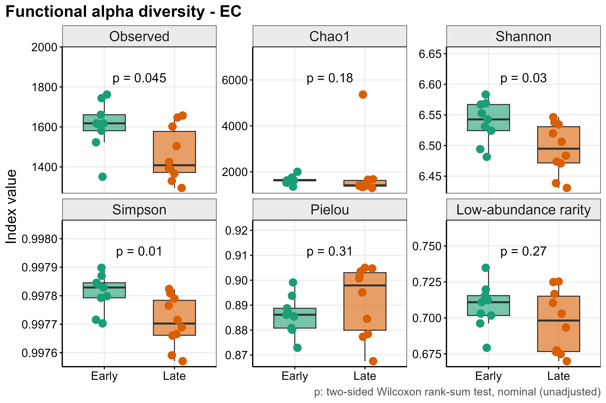
<p class="caption">
Figure 31. Functional alpha diversity, EC.
</p>

</div>

<div class="figure" style="text-align: center">

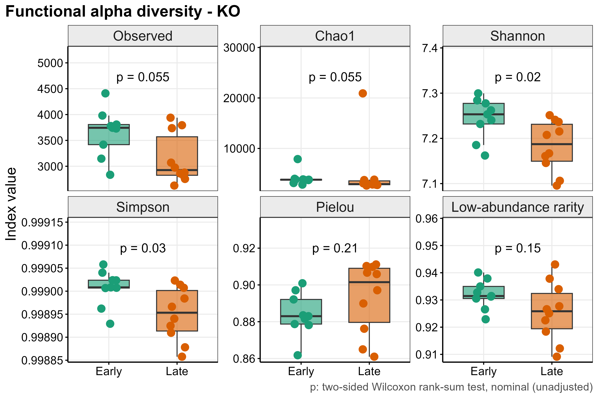
<p class="caption">
Figure 32. Functional alpha diversity, KO.
</p>

</div>

<div class="figure" style="text-align: center">

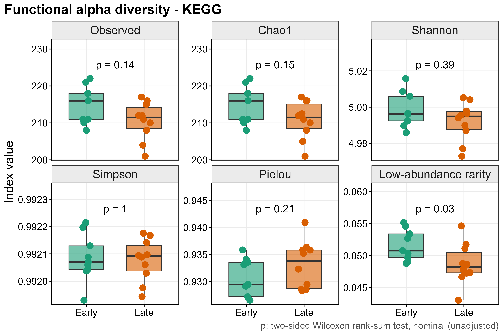
<p class="caption">
Figure 33. Functional alpha diversity, KEGG pathways.
</p>

</div>

<div class="figure" style="text-align: center">

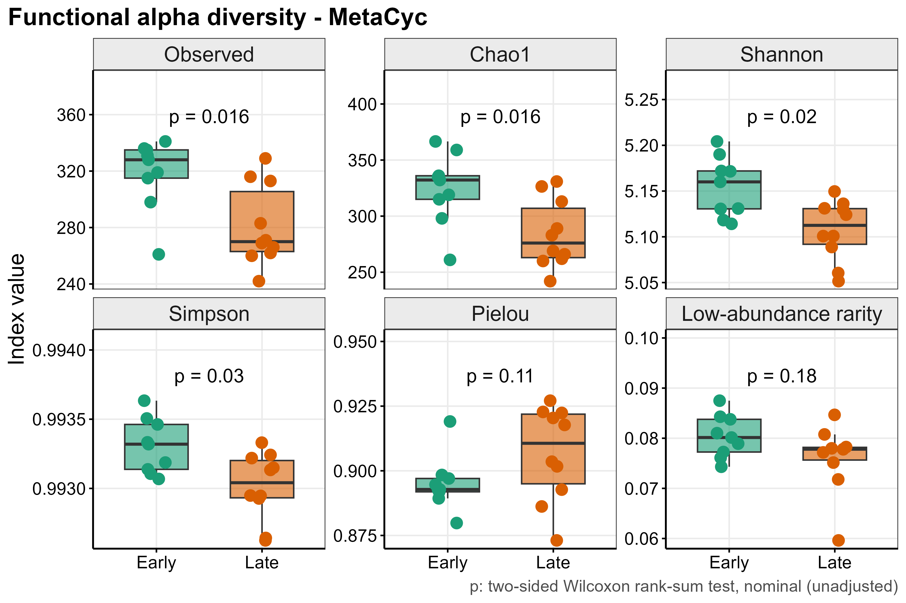
<p class="caption">
Figure 34. Functional alpha diversity, MetaCyc pathways.
</p>

</div>

- **Late samples have a slightly smaller predicted repertoire.** Medians
  fall from about 1,620 to 1,410 ECs (p = 0.045), 328 to 270 MetaCyc
  pathways (p = 0.016) and 3,750 to 2,930 KOs (p = 0.055). Shannon and
  Simpson are also lower (p = 0.01–0.03).
- **The taxa lost after weaning carried unique functions,** although
  taxonomic diversity did not change.
- **KEGG pathways barely change,** because broad pathways saturate.
- **Chao1 is unreliable** on rounded predictions.

## 13.3 Functional beta diversity

<div class="figure" style="text-align: center">

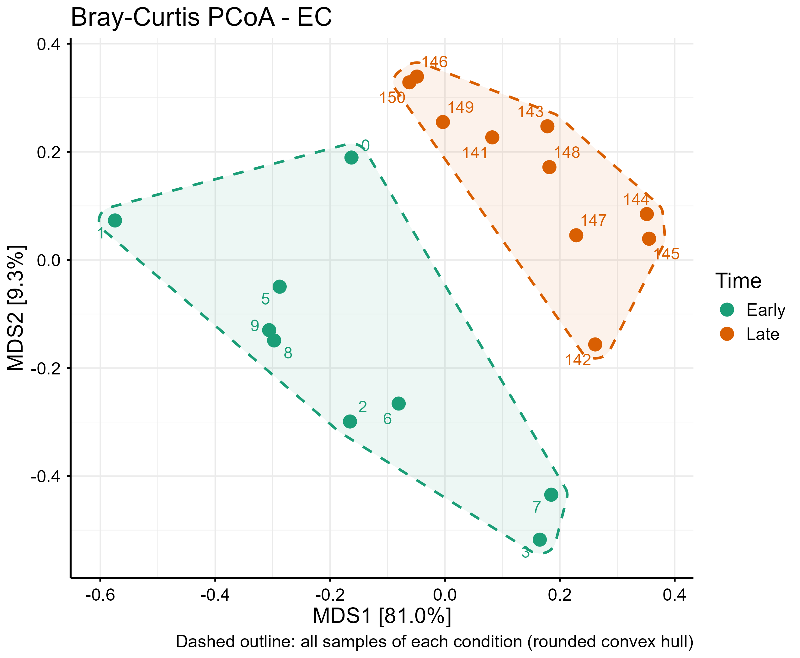
<p class="caption">
Figure 35. Bray–Curtis PCoA, EC; point labels = day.
</p>

</div>

<div class="figure" style="text-align: center">

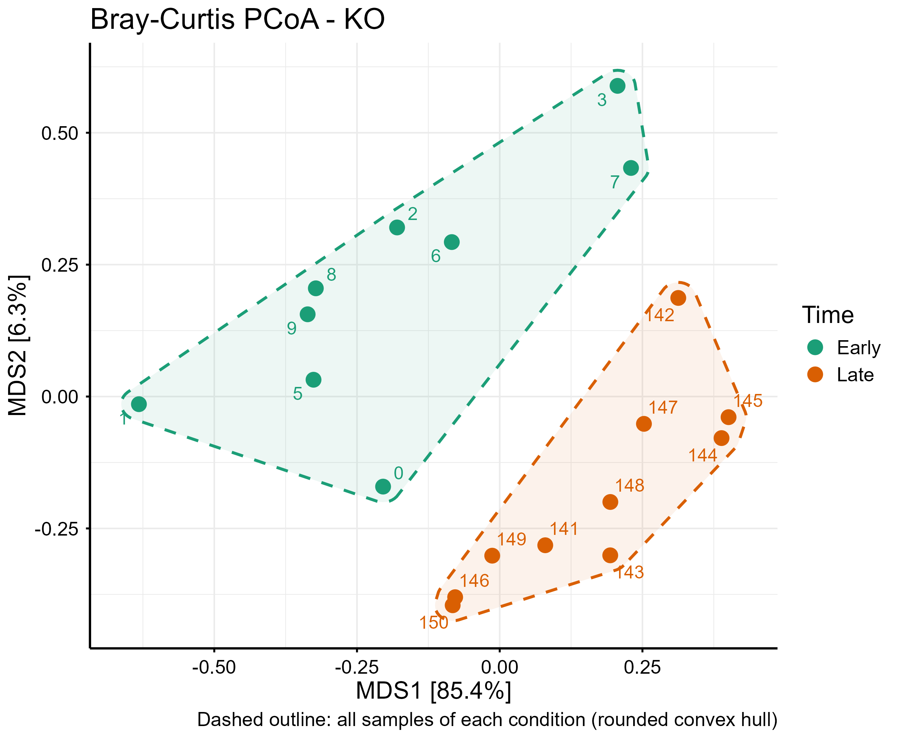
<p class="caption">
Figure 36. Bray–Curtis PCoA, KO; point labels = day.
</p>

</div>

<div class="figure" style="text-align: center">

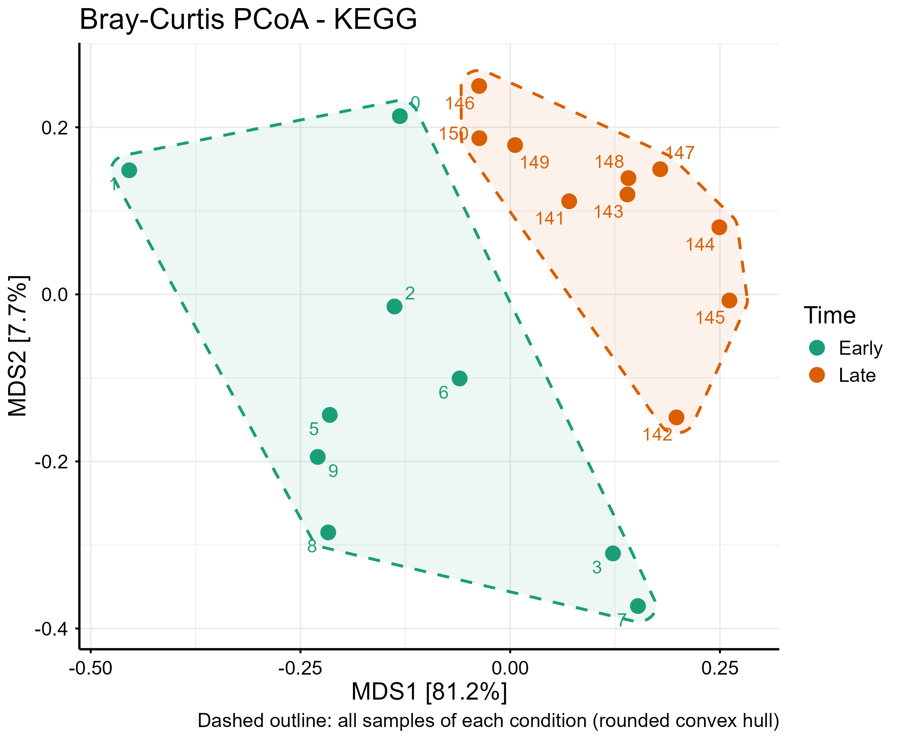
<p class="caption">
Figure 37. Bray–Curtis PCoA, KEGG; point labels = day.
</p>

</div>

<div class="figure" style="text-align: center">

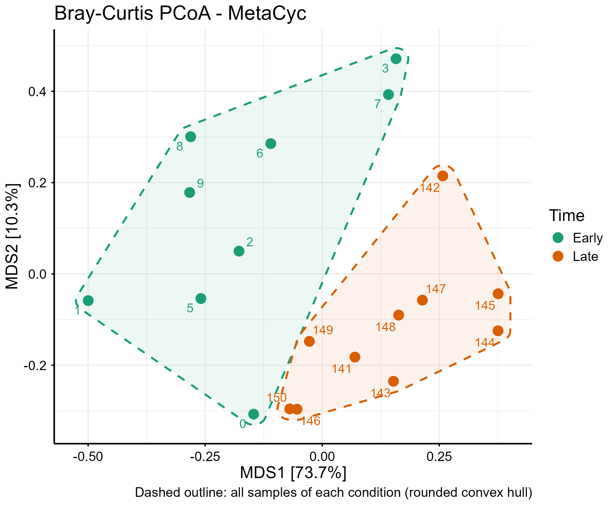
<p class="caption">
Figure 38. Bray–Curtis PCoA, MetaCyc; point labels = day.
</p>

</div>

- **MDS1 explains 74–85% of the variation** (taxa: 50%). Functional
  profiles are redundant, so sample differences collapse onto one
  Early-to-Late gradient, and the two conditions separate in every
  dataset.
- **E04 and E07 (days 3 and 7) sit near the Late samples** although
  their taxonomy is Early. This is **functional redundancy**: different
  taxa can supply similar genes.

## 13.4 PERMANOVA

| Dataset | Features | R² (%) | p_adj | PERMDISP p_adj |
|:--------|:---------|-------:|:------|:---------------|
| EC      | 1,905    |   38.9 | 0.003 | 0.237          |
| KO      | 4,725    |   36.9 | 0.004 | 0.237          |
| KEGG    | 228      |   38.2 | 0.003 | 0.237          |
| MetaCyc | 376      |   36.2 | 0.003 | 0.237          |

Table 14. PERMANOVA and PERMDISP on predicted functional profiles.

Time explains **36–39%** of the functional variation (p_adj ≤ 0.004),
with no dispersion difference. Function shifts strongly with age, but
slightly less than taxonomy (44%).

## 13.5 ANCOM-BC2

ANCOM-BC2 uses the same settings as Section 10. KEGG uses the KO table
to estimate the bias.

| Group   | Features_tested | Tested_pseudocount | Not_tested | Significant_q05 | Also_pass_sensitivity | Higher_in_Late | Higher_in_Early |
|:--------|----------------:|-------------------:|-----------:|----------------:|----------------------:|---------------:|----------------:|
| EC      |            1905 |                 62 |          0 |              56 |                    11 |              0 |              11 |
| KO      |            4725 |                215 |          0 |              73 |                    27 |              7 |              20 |
| KEGG    |             228 |                  3 |          0 |               7 |                     2 |              1 |               1 |
| MetaCyc |             376 |                 23 |          0 |              15 |                     3 |              0 |               3 |

Table 15. ANCOM-BC2 summary per functional dataset
(results/picrust2/ancombc2_results_by_group.xlsx, sheet ‘Summary’).

All 7,234 features were tested. **11 EC, 27 KO, 2 KEGG and 3 MetaCyc**
features are robust, and most are **higher in Early**. This matches the
smaller Late repertoire.

#### EC

| Feature   | Description                                             | Present E/L |   LFC | q       | Robust | Fit     |
|:----------|:--------------------------------------------------------|:------------|------:|:--------|:-------|:--------|
| 1.5.1.51  | N-((2S)-2-amino-2-carboxyethyl)-L-glutamate dehydrogena | 9/8         | -2.08 | 3.1e-06 | FALSE  | primary |
| 1.3.1.44  | Trans-2-enoyl-CoA reductase (NAD(+))                    | 9/4         | -2.60 | 5.2e-06 | TRUE   | primary |
| 2.1.1.242 | 16S rRNA (guanine(1516)-N(2))-methyltransferase         | 9/8         | -2.29 | 3.3e-05 | TRUE   | primary |
| 1.5.1.43  | Carboxynorspermidine synthase                           | 9/2         | -2.76 | 4.1e-05 | TRUE   | primary |
| 2.6.1.112 | (S)-ureidoglycine–glyoxylate transaminase               | 9/2         | -2.55 | 8.7e-05 | TRUE   | primary |
| 2.7.1.25  | Adenylyl-sulfate kinase                                 | 9/10        | -0.95 | 1.4e-04 | FALSE  | primary |
| 3.6.1.67  | Dihydroneopterin triphosphate diphosphatase             | 9/3         | -3.04 | 9.9e-04 | TRUE   | primary |
| 3.3.1.1   | Adenosylhomocysteinase                                  | 9/10        | -0.74 | 9.9e-04 | FALSE  | primary |
| 6.3.2.32  | Coenzyme gamma-F420-2:alpha-L-glutamate ligase          | 9/10        | -1.79 | 0.001   | TRUE   | primary |
| 1.11.1.10 | Chloride peroxidase                                     | 9/10        | -1.01 | 0.001   | TRUE   | primary |

Table 16a. ANCOM-BC2, EC (1,905 features; ten lowest p).

<div class="figure" style="text-align: center">

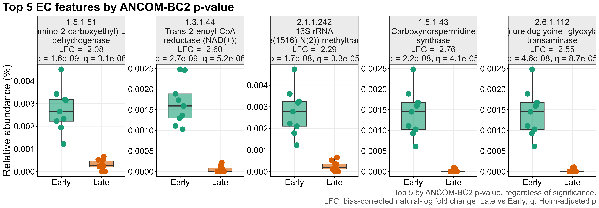
<p class="caption">
Figure 39. Top-5 EC numbers.
</p>

</div>

All five are 8- to 16-fold lower in Late samples. They include
carboxynorspermidine synthase (polyamine biosynthesis),
trans-2-enoyl-CoA reductase (fatty-acid synthesis and fermentation) and
ureidoglycine transaminase (purine degradation).

#### KO

| Feature   | Description                                             | Present E/L |   LFC | q       | Robust | Fit            |
|:----------|:--------------------------------------------------------|:------------|------:|:--------|:-------|:---------------|
| ko:K06936 | archaeosine synthase beta-subunit \[EC:2.6.1.-\]        | 9/0         | -3.64 | 3.5e-09 | TRUE   | pseudo-count 1 |
| ko:K07266 | capsular polysaccharide export protein                  | 9/0         | -3.64 | 3.5e-09 | TRUE   | pseudo-count 1 |
| ko:K19419 | transmembrane protein EpsG                              | 9/0         | -3.64 | 3.5e-09 | TRUE   | pseudo-count 1 |
| ko:K19504 | glucoselysine-6-phosphate deglycase                     | 9/0         | -3.64 | 3.5e-09 | TRUE   | pseudo-count 1 |
| ko:K21463 | membrane-associated protein TcaA                        | 9/0         | -3.64 | 3.5e-09 | TRUE   | pseudo-count 1 |
| ko:K21492 | antitoxin YqcF                                          | 9/0         | -3.64 | 3.5e-09 | TRUE   | pseudo-count 1 |
| ko:K05378 | phycoerythrin-associated linker protein                 | 0/10        |  3.29 | 7.4e-07 | TRUE   | pseudo-count 1 |
| ko:K09584 | protein disulfide-isomerase A6 \[EC:5.3.4.1\]           | 0/10        |  3.29 | 7.4e-07 | TRUE   | pseudo-count 1 |
| ko:K12062 | conjugal transfer pilin signal peptidase TrbI           | 0/10        |  3.29 | 7.4e-07 | TRUE   | pseudo-count 1 |
| ko:K17807 | mitochondrial translocator assembly and maintenance pro | 0/10        |  3.29 | 7.4e-07 | TRUE   | pseudo-count 1 |

Table 16b. ANCOM-BC2, KO (4,725 features; ten lowest p).

<div class="figure" style="text-align: center">

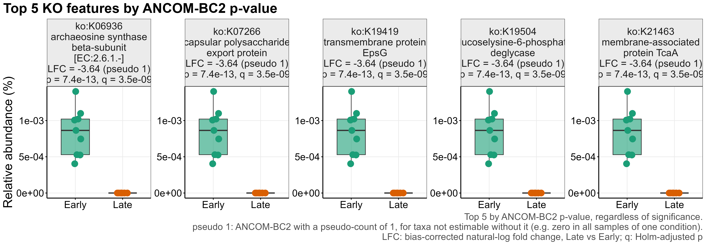
<p class="caption">
Figure 40. Top-5 KOs.
</p>

</div>

- **The top KOs have identical profiles** (present in all Early samples,
  absent from all Late samples). They come from the same Early-only
  taxa: **one signal, not five**.
- **Some Late-only KOs are implausible** for gut bacteria (a
  phycobilisome linker, a mitochondrial protein). They are inherited
  reference annotations.

#### KEGG

| Feature | Description                               | Present E/L |   LFC | q       | Robust | Fit            |
|:--------|:------------------------------------------|:------------|------:|:--------|:-------|:---------------|
| ko00196 | Photosynthesis - antenna proteins         | 0/10        |  2.63 | 1.1e-06 | TRUE   | pseudo-count 1 |
| ko04071 | Sphingolipid signaling pathway            | 9/10        |  1.20 | 3.3e-04 | FALSE  | primary        |
| ko00627 | Aminobenzoate degradation                 | 9/10        |  0.59 | 0.001   | FALSE  | primary        |
| ko00311 | Penicillin and cephalosporin biosynthesis | 9/10        |  0.85 | 0.007   | FALSE  | primary        |
| ko00791 | Atrazine degradation                      | 9/10        |  0.78 | 0.010   | FALSE  | primary        |
| ko00623 | Toluene degradation                       | 9/10        |  0.82 | 0.037   | FALSE  | primary        |
| ko05135 | Yersinia infection                        | 9/4         | -1.60 | 0.050   | TRUE   | primary        |
| ko04310 | Wnt signaling pathway                     | 2/5         | -1.37 | 0.051   | FALSE  | primary        |
| ko04330 | Notch signaling pathway                   | 2/5         | -1.37 | 0.051   | FALSE  | primary        |
| ko00410 | beta-Alanine metabolism                   | 9/10        |  0.43 | 0.061   | FALSE  | primary        |

Table 16c. ANCOM-BC2, KEGG (228 features; ten lowest p).

<div class="figure" style="text-align: center">

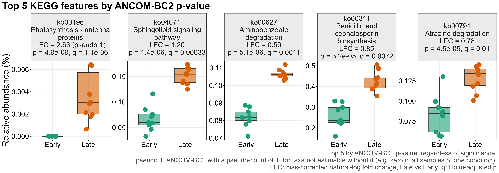
<p class="caption">
Figure 41. Top-5 KEGG pathways.
</p>

</div>

- **ko00196 (photosynthesis – antenna proteins)** is robust but an
  **artefact** of the phycobilisome KO.
- **Four pathways are clearly higher in Late** but fail the sensitivity
  analysis: sphingolipid signalling, aminobenzoate degradation, β-lactam
  biosynthesis and atrazine degradation.

#### MetaCyc

| Feature         | Description                                             | Present E/L |   LFC | q       | Robust | Fit            |
|:----------------|:--------------------------------------------------------|:------------|------:|:--------|:-------|:---------------|
| PWY-6565        | superpathway of polyamine biosynthesis III              | 9/2         | -2.52 | 1.3e-04 | TRUE   | primary        |
| PWY-6562        | norspermidine biosynthesis                              | 9/3         | -2.09 | 7.7e-04 | TRUE   | primary        |
| PWY-4984        | urea cycle                                              | 9/8         | -1.80 | 9.0e-04 | FALSE  | primary        |
| PWY-7316        | dTDP-N-acetylviosamine biosynthesis                     | 9/10        |  0.88 | 0.001   | FALSE  | primary        |
| PWY-7913        | firefly bioluminescence                                 | 8/0         | -2.56 | 0.004   | TRUE   | pseudo-count 1 |
| PWY-7052        | cyanophycin metabolism                                  | 1/8         | -2.42 | 0.005   | FALSE  | primary        |
| PWY0-1415       | superpathway of heme b biosynthesis from uroporphyrinog | 8/3         | -1.91 | 0.014   | FALSE  | primary        |
| SO4ASSIM-PWY    | assimilatory sulfate reduction I                        | 9/10        | -0.87 | 0.014   | FALSE  | primary        |
| SULFATE-CYS-PWY | superpathway of sulfate assimilation and cysteine biosy | 9/10        | -0.79 | 0.016   | FALSE  | primary        |
| PWY1ZNC-1       | assimilatory sulfate reduction IV                       | 9/10        | -0.81 | 0.020   | FALSE  | primary        |

Table 16d. ANCOM-BC2, MetaCyc (376 features; ten lowest p).

<div class="figure" style="text-align: center">

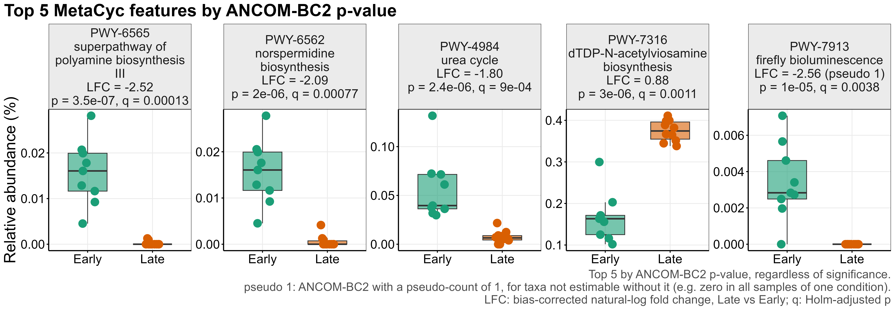
<p class="caption">
Figure 42. Top-5 MetaCyc pathways.
</p>

</div>

- **Polyamine (norspermidine) biosynthesis is robustly higher in
  Early.** PWY-6565 and PWY-6562 are present in all Early samples and
  only 2–3 Late samples. This is the same signal as the EC and KO
  results.
- **“Firefly bioluminescence”** is another annotation artefact.

## 13.6 Summary of the functional analysis

- **Function shifts with age** (R² 36–39%), and the Late repertoire is
  slightly narrower.
- **The most consistent signal is polyamine biosynthesis,** higher in
  Early at EC, KO and MetaCyc level.
- **Functional redundancy:** E04 and E07 are taxonomically Early but
  functionally Late-like.
- **Caveats.**
  - The results are **predictions** of potential, not activity, and are
    derived from the same 163 features.
  - Identical profiles count once.
  - Implausible pathways are artefacts.
  - The one-animal limitation applies.

------------------------------------------------------------------------

# 14. Tools and libraries

| Tool                                        | Version / source                        | Role                                                     |
|---------------------------------------------|-----------------------------------------|----------------------------------------------------------|
| nf-core/ampliseq \[1, 2\]                   | 2.18.0 (Nextflow \[9\], nf-core \[10\]) | upstream processing                                      |
| DADA2 \[3\], VSEARCH \[11\]                 | in ampliseq                             | ASVs, 97% clustering, SILVA 138.2 taxonomy               |
| QIIME 2 \[5\], q2-feature-classifier \[12\] | in ampliseq                             | SILVA 138 taxonomy                                       |
| PICRUSt2 \[6\]                              | 2.6.3, PICRUSt2-SC \[31\]               | functional prediction                                    |
| phyloseq \[13\]                             | Bioconductor                            | data handling, rarefying                                 |
| microViz \[20\]                             | r-universe                              | aggregation, diversity, ordination, PERMANOVA, bar plots |
| microbiome \[21\]                           | Bioconductor                            | evenness, rarity                                         |
| vegan \[22\]                                | CRAN                                    | rarefaction curves, adonis2, betadisper                  |
| ANCOMBC \[23\]                              | Bioconductor                            | ANCOM-BC2                                                |
| ggpicrust2 \[24\]                           | CRAN                                    | KO → KEGG pathways                                       |

------------------------------------------------------------------------

# References

1.  Straub D, Blackwell N, Langarica-Fuentes A, Peltzer A, Nahnsen S,
    Kleindienst S. Interpretations of environmental microbial community
    studies are biased by the selected 16S rRNA (gene) amplicon
    sequencing pipeline. Front Microbiol. 2020;11:550420.
2.  Straub D, Tångrot J, Lundin D, Peltzer A, et al. nf-core/ampliseq:
    Ampliseq version 2.18.0 \[software\]. Zenodo; 2026 Jun 17.
    <doi:10.5281/zenodo.20731730>
3.  Callahan BJ, McMurdie PJ, Rosen MJ, Han AW, Johnson AJA, Holmes SP.
    DADA2: high-resolution sample inference from Illumina amplicon data.
    Nat Methods. 2016;13(7):581–3.
4.  Quast C, Pruesse E, Yilmaz P, Gerken J, Schweer T, Yarza P, et
    al. The SILVA ribosomal RNA gene database project: improved data
    processing and web-based tools. Nucleic Acids Res.
    2013;41(D1):D590–6.
5.  Bolyen E, Rideout JR, Dillon MR, Bokulich NA, Abnet CC, Al-Ghalith
    GA, et al. Reproducible, interactive, scalable and extensible
    microbiome data science using QIIME 2. Nat Biotechnol.
    2019;37(8):852–7.
6.  Douglas GM, Maffei VJ, Zaneveld JR, Yurgel SN, Brown JR, Taylor CM,
    et al. PICRUSt2 for prediction of metagenome functions. Nat
    Biotechnol. 2020;38(6):685–8.
7.  Kozich JJ, Westcott SL, Baxter NT, Highlander SK, Schloss PD.
    Development of a dual-index sequencing strategy and curation
    pipeline for analyzing amplicon sequence data on the MiSeq Illumina
    sequencing platform. Appl Environ Microbiol. 2013;79(17):5112–20.
8.  Schloss PD, Schubert AM, Zackular JP, Iverson KD, Young VB,
    Petrosino JF. Stabilization of the murine gut microbiome following
    weaning. Gut Microbes. 2012;3(4):383–93.
9.  Di Tommaso P, Chatzou M, Floden EW, Barja PP, Palumbo E,
    Notredame C. Nextflow enables reproducible computational workflows.
    Nat Biotechnol. 2017;35(4):316–9.
10. Ewels PA, Peltzer A, Fillinger S, Patel H, Alneberg J, Wilm A, et
    al. The nf-core framework for community-curated bioinformatics
    pipelines. Nat Biotechnol. 2020;38(3):276–8.
11. Rognes T, Flouri T, Nichols B, Quince C, Mahé F. VSEARCH: a
    versatile open source tool for metagenomics. PeerJ. 2016;4:e2584.
12. Bokulich NA, Kaehler BD, Rideout JR, Dillon M, Bolyen E, Knight R,
    et al. Optimizing taxonomic classification of marker-gene amplicon
    sequences with QIIME 2’s q2-feature-classifier plugin. Microbiome.
    2018;6(1):90.
13. McMurdie PJ, Holmes S. phyloseq: an R package for reproducible
    interactive analysis and graphics of microbiome census data. PLoS
    One. 2013;8(4):e61217.
14. Institute for Cyber-Enabled Research (ICER), Michigan State
    University. Writing and submitting job scripts. MSU HPCC User
    Documentation \[Internet\]. Available from:
    <https://docs.icer.msu.edu/Job_Script_and_Job_Submission/>
15. MSU Bioinformatics Core. Using nf-core pipelines on the MSU HPCC
    \[Internet\]. Available from:
    <https://msubioinformaticscore.github.io/nf-core>
16. Wang Q, Garrity GM, Tiedje JM, Cole JR. Naive Bayesian classifier
    for rapid assignment of rRNA sequences into the new bacterial
    taxonomy. Appl Environ Microbiol. 2007;73(16):5261–7.
17. SILVA. Release information: SILVA 138.2 \[Internet\]. 2024 Jul 11.
    Available from:
    <https://www.arb-silva.de/documentation/release-1382>
18. Zheng J, Wittouck S, Salvetti E, Franz CMAP, Harris HMB, Mattarelli
    P, et al. A taxonomic note on the genus Lactobacillus: description
    of 23 novel genera, emended description of the genus Lactobacillus
    Beijerinck 1901, and union of Lactobacillaceae and Leuconostocaceae.
    Int J Syst Evol Microbiol. 2020;70(4):2782–858.
19. Callahan B. Silva taxonomic training data formatted for DADA2 (Silva
    version 138.2) \[data set\]. Zenodo; 2024.
    <doi:10.5281/zenodo.14169026>
20. Barnett DJM, Arts ICW, Penders J. microViz: an R package for
    microbiome data visualization and statistics. J Open Source Softw.
    2021;6(63):3201.
21. Lahti L, Shetty S, et al. Tools for microbiome analysis in R.
    microbiome R package. Bioconductor; 2017. Available from:
    <https://microbiome.github.io/microbiome>
22. Oksanen J, Simpson GL, Blanchet FG, Kindt R, Legendre P, Minchin PR,
    et al. vegan: Community Ecology Package. R package. Available from:
    <https://CRAN.R-project.org/package=vegan>
23. Lin H, Peddada SD. Multigroup analysis of compositions of
    microbiomes with covariate adjustments and repeated measures. Nat
    Methods. 2024;21(1):83–91.
24. Yang C, Mai J, Cao X, Burberry A, Cominelli F, Zhang L. ggpicrust2:
    an R package for PICRUSt2 predicted functional profile analysis and
    visualization. Bioinformatics. 2023;39(8):btad470.
25. McMurdie PJ, Holmes S. Waste not, want not: why rarefying microbiome
    data is inadmissible. PLoS Comput Biol. 2014;10(4):e1003531.
26. Anderson MJ. A new method for non-parametric multivariate analysis
    of variance. Austral Ecol. 2001;26(1):32–46.
27. Anderson MJ. Distance-based tests for homogeneity of multivariate
    dispersions. Biometrics. 2006;62(1):245–53.
28. Benjamini Y, Hochberg Y. Controlling the false discovery rate: a
    practical and powerful approach to multiple testing. J R Stat Soc
    Series B. 1995;57(1):289–300.
29. Holm S. A simple sequentially rejective multiple test procedure.
    Scand J Stat. 1979;6(2):65–70.
30. Caspi R, Billington R, Keseler IM, Kothari A, Krummenacker M,
    Midford PE, et al. The MetaCyc database of metabolic pathways and
    enzymes – a 2019 update. Nucleic Acids Res. 2020;48(D1):D445–53.
31. Wright RJ, Langille MGI. PICRUSt2-SC: an update to the reference
    database used for functional prediction within PICRUSt2.
    Bioinformatics. 2025;41(5):btaf269.
32. Kanehisa M, Goto S. KEGG: Kyoto Encyclopedia of Genes and Genomes.
    Nucleic Acids Res. 2000;28(1):27–30.
